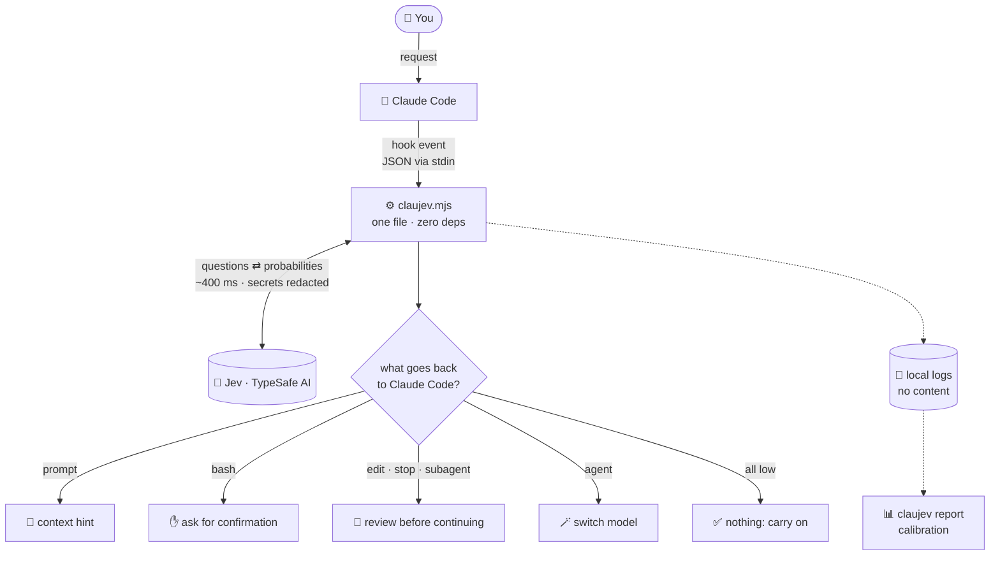

<p align="center">
  
</p>

<p align="center">
  <a href="README.md">Português</a> · <b>English</b>
</p>

---

**ClauJev** plugs [Jev](https://typesafe.ai), TypeSafe AI's fast judgment model, into Claude Code
[hooks](https://docs.claude.com/en/docs/claude-code/hooks). While Claude works, Jev answers short,
typed questions about what is happening. Examples: *"is this command destructive?"*, *"does this
edit break a project rule?"* and *"was the request fully done?"*. ClauJev turns those answers
into action.

- 🧭 **Triage**: tells Claude whether the request is a question, a small change, a big change, or too vague.
- 🛑 **Command guard**: asks for your confirmation before destructive or credential-touching commands.
- 🔍 **Rule review**: checks every edit against rules you write in plain language.
- ✅ **Final check**: blocks "done!" when the request looks incomplete, unfinished, or `verify` fails.
- 🪄 **Subagent routing**: sends simple subagent tasks to a smaller, faster model.
- 🕵️ **False-claim detector**: catches subagents that report work they never did.

It is **one Node.js file with zero dependencies**. Each event takes about **400 ms** and costs a
fraction of a cent. In six days of real use: ~2,090 calls, ~1.7M input tokens, **~US$ 0.07 total**.

> [!NOTE]
> Community project, not affiliated with TypeSafe AI or Anthropic. You need your own
> [TypeSafe AI](https://typesafe.ai) API key. Code comments and Claude-facing messages are in
> Portuguese; the questions sent to Jev work in any language.

## How it works



Three principles:

1. **Never break the session.** Any error (no key, API down, 3 s timeout) is logged and Claude carries on.
2. **Observe before acting.** Every hook starts in `observe` mode: it only logs. Switch to `enforce` once the numbers look right.
3. **A signal, not a verdict.** ClauJev never deletes or reverts anything. At most it asks you, or asks Claude to double-check.

Every Jev answer becomes a value in 0..1 and falls into a **low / uncertain / high** band.
Only **high** acts, and only in `enforce` mode. **Uncertain** is logged for calibration.

## Install

Requires **Node.js 20+**, **git** and a **TypeSafe AI key**.

```bash
git clone https://github.com/Civalski/claujev.git
cd claujev
node install.mjs
echo "TYPESAFE_API_KEY=your_key" > ~/.claude/hooks/claujev/.env
node ~/.claude/hooks/claujev/claujev.mjs selftest
```

Then open a new Claude Code session. The installer keeps your other hooks, backs up
`settings.json`, and never overwrites your `config.json` or `.env`. Works on Linux, macOS and
Windows. Remove with `node install.mjs --uninstall`.

## Configure

Three layers, last one wins: built-in defaults → `~/.claude/hooks/claujev/config.json` →
`<project>/.claude/claujev.json`.

```json
{
  "hooks": { "bash": "enforce", "stop": "enforce", "edit": "observe" },
  "rules": ["Never query the database inside a loop."],
  "areas": { "frontend": { "description": "UI, components, CSS", "hint": "Check the result in the browser before finishing." } },
  "context": ["CLAUDE.md"],
  "verify": "npm test --silent",
  "questions": {
    "stop": {
      "change_risk": {
        "type": "score",
        "instructions": "How likely is this change to break production?",
        "criteria": ["Trivial", "Low", "Medium", "High", "Critical"],
        "act": { "threshold": { "low": 0.5, "high": 0.75 }, "message": "high risk: ask for human review" }
      }
    }
  }
}
```

See the [Portuguese README](README.md#configuração) for every option, and
[`docs/perguntas.md`](docs/perguntas.md) for the exact questions each hook sends.

## Calibrate

```bash
node ~/.claude/hooks/claujev/claujev.mjs report
```

The report shows, per hook: calls, errors, flagged, uncertain, acted, average latency and cost.
Per question it shows the distribution (median, p90, max, quartile counts), so you can tune
`thresholds` before turning on `enforce`.

## Privacy

Sent to `api.typesafe.ai`: your request text, commands, edited snippets, the turn diff, the start
of `context` files and `verify` output, after redacting private keys and tokens. Local logs store
answers, latency and a content **hash**, not the content itself.

## License

[MIT](LICENSE) © Alisson Civalski
