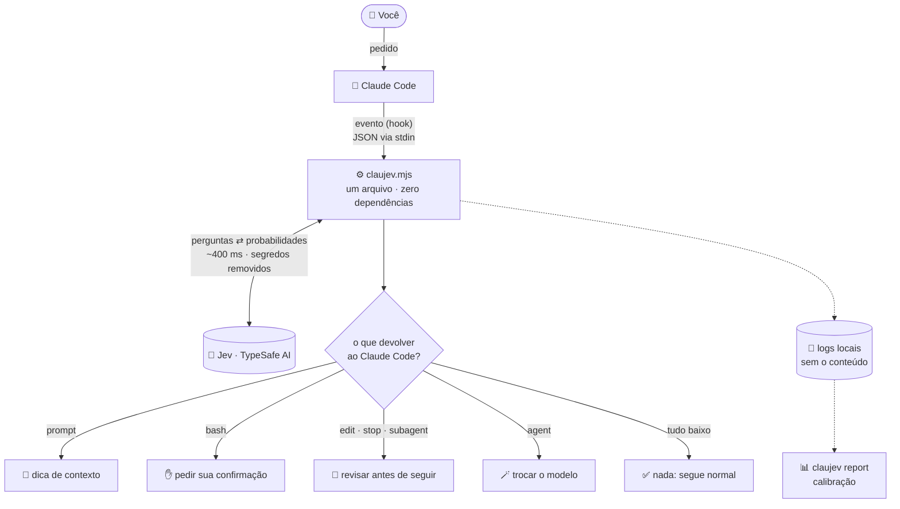
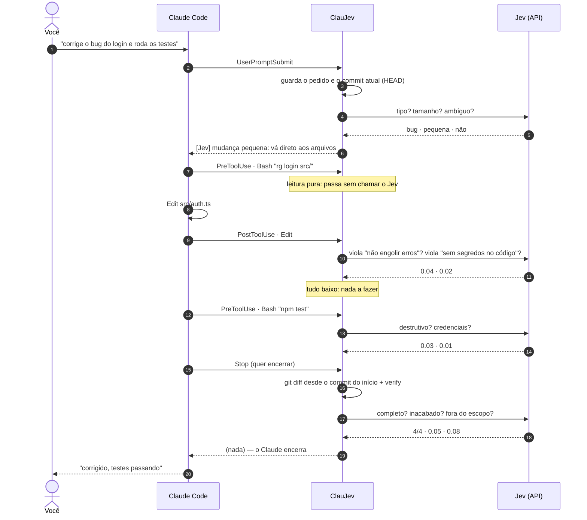
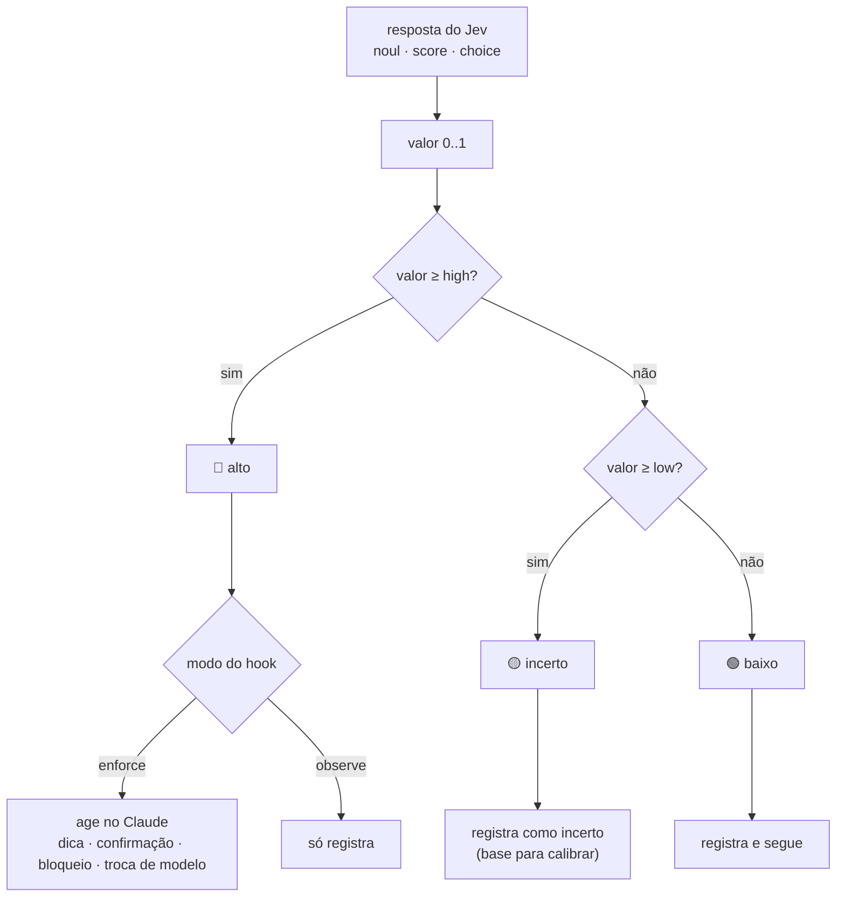
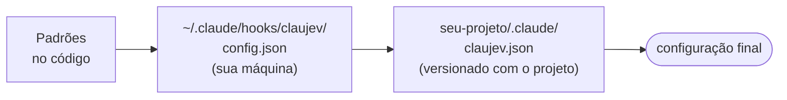

<p align="center">
  
</p>

<p align="center">
  <a href="LICENSE"></a>
  
  
</p>

<p align="center">
  <b>Português</b> · <a href="README.en.md">English</a>
</p>

---

**ClauJev** liga o [Jev](https://typesafe.ai), o modelo de julgamento rápido da TypeSafe AI, aos
[hooks](https://docs.claude.com/en/docs/claude-code/hooks) do Claude Code. Enquanto o Claude
trabalha, o Jev responde perguntas curtas e objetivas sobre o que está acontecendo. Exemplos:
*"este comando é destrutivo?"*, *"esta edição viola alguma regra do projeto?"* e
*"o pedido foi atendido por completo?"*. O ClauJev transforma essas respostas em ação.

- 🧭 **Orienta** o Claude no começo de cada pedido: se é pergunta, mudança pequena ou grande, ou se o pedido está vago.
- 🛑 **Pede sua confirmação** antes de comandos destrutivos ou que mexem com credenciais.
- 🔍 **Revisa cada edição** contra as regras que você escreve em português comum.
- ✅ **Confere o trabalho antes de encerrar**: completude, sobras inacabadas, testes que falharam.
- 🪄 **Manda subagentes simples para um modelo menor**, mais rápido e mais barato.
- 🕵️ **Pega subagentes que dizem ter feito o que não fizeram.**

Tudo isso é **um único arquivo** de Node.js, sem dependências. Cada evento leva cerca de **400 ms**
e custa frações de centavo.

> [!NOTE]
> Projeto da comunidade, sem vínculo oficial com a TypeSafe AI nem com a Anthropic.
> Você precisa de uma chave própria da [TypeSafe AI](https://typesafe.ai).

---

## Sumário

- [Por que existe](#por-que-existe)
- [Como funciona](#como-funciona)
- [Os seis recursos](#os-seis-recursos)
- [Um turno, do pedido ao fim](#um-turno-do-pedido-ao-fim)
- [Observar antes de agir: as faixas de decisão](#observar-antes-de-agir-as-faixas-de-decisão)
- [Instalação](#instalação)
- [Configuração](#configuração)
- [Calibrando com o relatório](#calibrando-com-o-relatório)
- [Uso real](#uso-real)
- [Privacidade e segurança](#privacidade-e-segurança)
- [Perguntas frequentes](#perguntas-frequentes)

---

## Por que existe

Agentes de programação são ótimos, mas erram de jeitos previsíveis:

| O agente…                                              | O ClauJev…                                                    |
| ------------------------------------------------------ | ------------------------------------------------------------- |
| explora o repositório inteiro para mudar uma linha     | avisa que a mudança é pequena e pede para ir direto ao ponto  |
| começa a editar um pedido vago                         | sugere perguntar antes                                        |
| roda `git push --force` ou `rm -rf` sem pensar duas vezes | segura o comando e pede a sua confirmação                  |
| deixa `TODO`, `catch {}` vazio ou chave no código      | aponta a regra violada logo depois da edição                  |
| diz "pronto!" com metade do pedido feito               | impede o encerramento e lista o que falta                     |
| usa o modelo mais caro para buscar um arquivo          | troca o subagente para um modelo menor                        |
| relata "testei e passou" sem ter rodado teste          | compara o relatório com as ações reais                        |

Um LLM grande poderia fazer essas checagens, mas seria lento e caro para rodar a cada comando.
O Jev foi feito para isso: recebe um texto e devolve **probabilidades tipadas** (sim/não, nota
numa escala, escolha entre opções) em poucas centenas de milissegundos.

---

## Como funciona

O Claude Code dispara eventos (hooks) em pontos fixos da conversa. O ClauJev escuta seis deles.
Em cada um, monta um pequeno *estado* com o que importa naquele momento, faz ao Jev as
perguntas certas e devolve ao Claude uma ação ou nada.



Três princípios guiam o código:

1. **Nunca quebrar a sessão.** Qualquer erro (sem chave, API fora, timeout de 3 s) vai para o log e o Claude segue normalmente.
2. **Observar antes de agir.** Todo hook começa em modo `observe`: só registra. Você liga `enforce` quando confia nos números.
3. **Sinal, não sentença.** O ClauJev nunca apaga nem desfaz nada. No máximo pede sua confirmação ou pede ao Claude para revisar. Falso positivo custa uma frase do Claude dizendo "conferi, está certo".

---

## Os seis recursos

| Evento | Recurso | O que o Jev responde | O que acontece em `enforce` |
| --- | --- | --- | --- |
| `UserPromptSubmit` | **Triagem do pedido** | tipo (pergunta, bug, feature, refatoração, config), tamanho (0–4), ambiguidade, área do projeto | dica injetada no contexto do Claude: *"só pergunta, não edite"*, *"mudança pequena, vá direto"*, *"pedido vago, pergunte antes"* |
| `PreToolUse` · Bash | **Guarda de comandos** | o comando é destrutivo/irreversível? mexe com credenciais? | o Claude Code **pede a sua confirmação** (nunca bloqueia sozinho) |
| `PreToolUse` · Agent | **Roteamento de subagente** | a tarefa é simples o bastante para um modelo pequeno? | o subagente roda com o modelo de `routeModel` (padrão `haiku`) |
| `PostToolUse` · Edit | **Revisão por regras** | esta alteração viola a regra X? (uma pergunta por regra, até 20) | o Claude recebe a lista de regras violadas e revisa o trecho |
| `SubagentStop` | **Detector de relatório falso** | o relatório afirma trabalho que não aparece nas ações executadas? | o subagente é mandado corrigir o relatório ou fazer o que falta |
| `Stop` | **Conferência final** | quanto do pedido foi atendido (0–4)? há trabalho inacabado? mudou coisa fora do escopo? + perguntas suas | o Claude não encerra: recebe a lista de problemas e confere |

Detalhes que fazem diferença:

- **Atalho de leitura.** `git status`, `ls`, `cat arquivo` e afins passam direto, sem chamar o Jev. Qualquer `;`, `|`, `&&`, `$(…)` ou arquivo sensível (`.env`, `.ssh`, `token`) cancela o atalho.
- **Respostas curtas continuam o pedido.** "sim", "pode seguir" são somados ao pedido anterior antes da triagem.
- **O Stop olha o diff real.** O ClauJev guarda o commit do início do turno e compara só os arquivos que o Claude editou, mesmo que ele tenha commitado no meio do caminho.
- **Verificação opcional.** Com `verify: "npm test --silent"`, o Stop roda o comando e um código de saída diferente de zero já impede o encerramento.

O texto exato de cada pergunta está em [`docs/perguntas.md`](docs/perguntas.md).

---

## Um turno, do pedido ao fim



Se no passo do Stop o Jev tivesse dado completude 2/4, o Claude receberia
*"[Jev] Antes de encerrar: o pedido pode não estar completo (nota 50/100). Confira o pedido
original contra o que foi feito"* e continuaria trabalhando.

---

## Observar antes de agir: as faixas de decisão

Cada resposta do Jev vira um número de 0 a 1 e cai numa de três faixas. Só a faixa **alta**
age, e só se o hook estiver em `enforce`. A faixa **incerta** existe para você calibrar: ela
aparece no relatório, mas nunca interrompe o Claude.



Os limites padrão (`low` / `high`):

| Pergunta | low | high |
| --- | --- | --- |
| pedido ambíguo | 0.50 | 0.70 |
| edição viola regra | 0.50 | 0.85 |
| pedido incompleto (1 − completude) | 0.25 | 0.40 |
| trabalho inacabado | 0.50 | 0.85 |
| comando destrutivo | 0.50 | 0.85 |
| comando com credenciais | 0.50 | 0.70 |
| subagente simples | 0.50 | 0.80 |
| relatório falso do subagente | 0.50 | 0.80 |

---

## Instalação

Pré-requisitos: **Node.js 20+**, **git** e uma **chave da [TypeSafe AI](https://typesafe.ai)**.

```bash
git clone https://github.com/Civalski/claujev.git
cd claujev
node install.mjs
```

O instalador:

1. copia `hooks/claujev.mjs` para `~/.claude/hooks/claujev/` (use `--link` para symlink, se for editar o código);
2. cria `config.json` e `.env` **só se ainda não existirem** (atualizar nunca apaga seus ajustes);
3. registra os seis hooks em `~/.claude/settings.json`, **mantendo seus outros hooks** e salvando um backup em `settings.json.claujev-backup`.

Depois:

```bash
# 1. cole a chave
echo "TYPESAFE_API_KEY=sua_chave" > ~/.claude/hooks/claujev/.env

# 2. teste a conexão
node ~/.claude/hooks/claujev/claujev.mjs selftest

# 3. abra uma conversa nova no Claude Code
```

Funciona em Linux, macOS e Windows. Para atualizar: `git pull && node install.mjs`.
Para remover: `node install.mjs --uninstall` (seus arquivos em `~/.claude/hooks/claujev` ficam;
apague a pasta se quiser).

---

## Configuração

A configuração vem em três camadas, e a de cima vence:



Objetos são mesclados chave a chave. `rules` e `ignoreFiles` são **somados** entre as camadas.
Use `"replace_rules": true` para trocar as regras em vez de somar.

### Modo de cada hook

```json
{
  "hooks": {
    "prompt": "enforce",
    "bash": "enforce",
    "edit": "observe",
    "stop": "enforce",
    "agent": "observe",
    "subagent": "off"
  }
}
```

`observe` só registra · `enforce` age no Claude · `off` nem chama o Jev.

### Regras do projeto

Escreva em linguagem natural. Cada regra vira uma pergunta sim/não sobre cada edição.

```json
{
  "rules": [
    "Não fazer consultas ao banco dentro de laços; busque tudo de uma vez.",
    "Não alterar arquivos de migração já aplicados; crie uma migração nova."
  ]
}
```

Já vêm três regras padrão: sem código incompleto, sem segredos no código e sem erros engolidos.

### Áreas, contexto e verificação

```json
{
  "areas": {
    "frontend": {
      "description": "Telas, componentes, CSS ou interface",
      "hint": "Tarefa de interface: confira o resultado visual no navegador antes de encerrar."
    }
  },
  "context": ["CLAUDE.md", "docs/ARQUITETURA.md"],
  "verify": "npm test --silent"
}
```

- **areas**: o Jev classifica cada pedido numa área e o Claude recebe a `hint` dela.
- **context**: o começo desses arquivos entra no estado das edições e do Stop, para o Jev julgar com o contexto do projeto.
- **verify**: comando rodado no Stop (timeout de 45 s). Se falhar, o Claude não encerra.

### Perguntas suas

Você pode fazer ao Jev qualquer pergunta extra no `stop` ou no `edit`, com três tipos de resposta:

| Tipo | Responde | Vira 0..1 como |
| --- | --- | --- |
| `noul` | sim/não com probabilidade | a própria probabilidade de "sim" |
| `score` | nota numa escala que você define em `criteria` | posição na escala |
| `choice` | uma entre várias opções | soma das probabilidades das opções em `act.choices` |

```json
{
  "questions": {
    "stop": {
      "change_risk": {
        "type": "score",
        "instructions": "Qual o risco desta mudança quebrar algo em produção?",
        "criteria": ["Trivial", "Baixo", "Médio", "Alto", "Crítico"],
        "act": { "threshold": { "low": 0.5, "high": 0.75 }, "message": "risco alto: peça revisão humana" }
      }
    }
  }
}
```

Sem `act`, a pergunta só é registrada no log, o que serve para medir antes de decidir.
Um exemplo completo está em [`examples/claujev.json`](examples/claujev.json).

### Todas as opções

| Chave | Padrão | Para quê |
| --- | --- | --- |
| `enabled` | `true` | liga/desliga tudo |
| `model` | `"jev-latest"` | modelo do Jev |
| `timeoutMs` | `3000` | tempo máximo de cada chamada |
| `hooks` | tudo `observe` | modo de cada hook |
| `thresholds` | ver tabela acima | faixas `low`/`high` de cada pergunta |
| `routeModel` | `"haiku"` | modelo usado em subagentes simples |
| `rules` | 3 regras | regras checadas a cada edição |
| `areas` | `{}` | áreas do projeto com dicas |
| `context` / `contextChars` | `[]` / `4000` | arquivos de contexto e quanto ler de cada |
| `verify` / `verifyTimeoutMs` | `null` / `45000` | comando de verificação no Stop |
| `questions` | `{}` | perguntas extras para `stop` e `edit` |
| `ignoreFiles` | lockfiles, imagens, `.min.js` | edições ignoradas |
| `checkDocs` | `false` | se `.md`, `.txt` e `.json` também passam pela revisão de regras |
| `maxDiffChars` | `30000` | tamanho máximo do diff enviado no Stop |

Variáveis de ambiente: `TYPESAFE_API_KEY` (alternativa ao `.env`), `CLAUJEV_HOME` (outra pasta
de instalação) e `CLAUJEV_DISABLED=1` (desliga para uma sessão).

---

## Calibrando com o relatório

```bash
node ~/.claude/hooks/claujev/claujev.mjs report
```

O relatório mostra:

- **por hook:** chamadas, erros, quantas vezes sinalizou, ficou incerto ou agiu, latência média e custo;
- **por pergunta:** mediana, p90, máximo e quantas respostas caíram em cada quarto de 0..1;
- **últimos eventos sinalizados**, para você conferir se foram acertos.

O fluxo sugerido é deixar tudo em `observe` por alguns dias, olhar a distribuição e só então
ligar `enforce` nos hooks em que o sinal faz sentido. Se uma pergunta vive na faixa incerta,
ajuste o `high` dela ou reescreva a regra.

---

## Uso real

Seis dias de uso diário do autor, num monorepo com API, CRM e integração com ERP:

| Hook | Chamadas | Agiu | Latência média | Custo |
| --- | ---: | ---: | ---: | ---: |
| bash | 1.661 | 112 | 408 ms | US$ 0,043 |
| prompt | 264 | 167 | 462 ms | US$ 0,010 |
| edit | 131 | 0 | 404 ms | US$ 0,013 |
| stop | 30 | 11 | 473 ms | US$ 0,005 |
| agent / subagent | 4 | 1 | ~360 ms | < US$ 0,001 |
| **total** | **~2.090** | | **~410 ms** | **~US$ 0,07** |

Cerca de 1,7 milhão de tokens de entrada por **sete centavos de dólar** (a saída do Jev não é
cobrada). O Stop pediu uma segunda conferência em 11 de 30 turnos com edição. Nenhuma edição foi bloqueada por regra, e a distribuição mostra que as regras
padrão ficam quase sempre abaixo de 0,1.

---

## Privacidade e segurança

**O que vai para a API do Jev** (`api.typesafe.ai`): o texto do seu pedido, os comandos que o
Claude quer rodar, os trechos editados, o diff do turno, o começo dos arquivos de `context` e a
saída do `verify`. Antes de sair da máquina, tudo passa por um filtro que remove chaves
privadas, tokens (`sk-…`, `ghp_…`, `Bearer …`) e pares `senha=`/`token=`/`api_key=`. Leia os
[termos da TypeSafe AI](https://typesafe.ai) antes de usar em código sob sigilo.

**O que fica na sua máquina:** os logs em `~/.claude/hooks/claujev/logs/` guardam respostas,
latência e um *hash* do conteúdo, **não o conteúdo em si**. O estado do turno fica em `state/`.

**O que o ClauJev nunca faz:** apagar, desfazer ou alterar seus arquivos; aprovar comando por
você (no máximo, transforma "aprovado" em "pergunte ao usuário"); travar a sessão (timeouts
curtos e qualquer erro é engolido e registrado).

---

## Perguntas frequentes

<details>
<summary><b>Isso deixa o Claude Code mais lento?</b></summary>

Cada evento verificado soma cerca de 400 ms. Comandos de leitura pura não chamam o Jev. Na prática,
a espera é bem menor que o tempo de resposta do próprio Claude.
</details>

<details>
<summary><b>E se o Jev errar?</b></summary>

As ações são reversíveis por desenho. Uma dica errada vira uma linha a mais no contexto; um bloqueio
errado no Stop custa uma frase do Claude dizendo que conferiu. Os limites `high` são altos de
propósito, e a faixa incerta nunca age.
</details>

<details>
<summary><b>O Jev vê a conversa toda?</b></summary>

Não. Ele vê só o estado montado para cada pergunta: o pedido, o comando ou o diff. Por isso a
pergunta de ambiguidade avisa explicitamente que referências como "isso" ou "esse arquivo" são
normais numa conversa em andamento.
</details>

<details>
<summary><b>Qual a diferença para o plugin oficial <code>typesafe@typesafe-ai</code>?</b></summary>

O plugin oficial é uma *skill*: ensina o Claude a escrever código que **usa** a API do Jev nos seus
projetos. O ClauJev usa o Jev para **supervisionar o próprio Claude** enquanto ele trabalha. Os dois
convivem sem conflito.
</details>

<details>
<summary><b>Como desligo rapidamente?</b></summary>

`CLAUJEV_DISABLED=1 claude` para uma sessão, `"enabled": false` no `config.json` para sempre, ou
`node install.mjs --uninstall` para remover os hooks.
</details>

---

## Contribuindo

Issues e PRs são bem-vindos. O projeto é deliberadamente pequeno: um arquivo, sem dependências.

```bash
npm test            # testes (node:test, sem rede)
npm run selftest    # chamada real ao Jev (precisa de chave)
```

## Licença

[MIT](LICENSE) © Alisson Civalski
