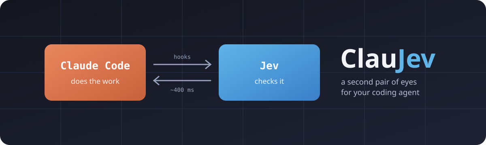
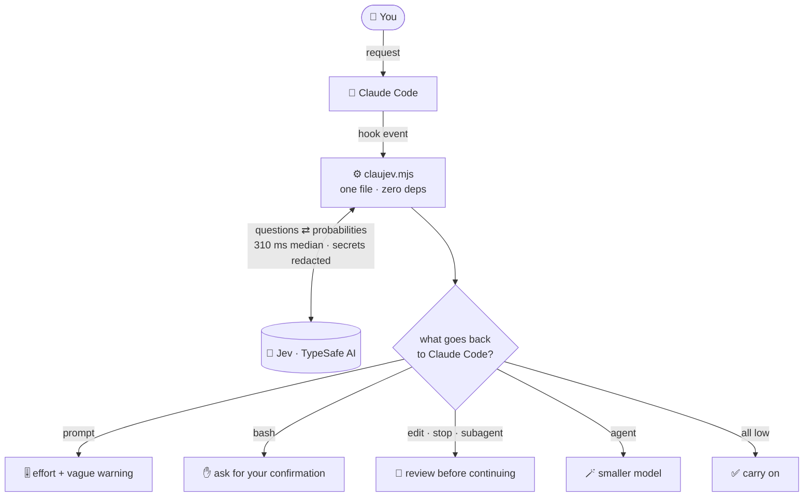
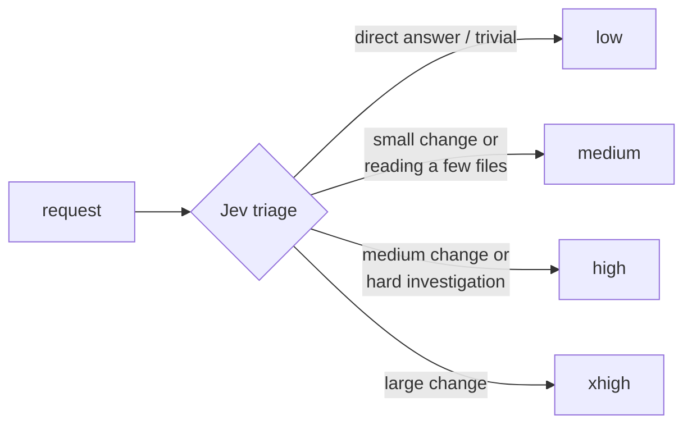

<p align="center">
  
</p>

<p align="center">
  <a href="LICENSE"></a>
  
  
</p>

<p align="center">
  <b>English</b> · <a href="README.pt-BR.md">Português</a> · <a href="https://civalski.github.io/claujev/">Website</a> · <a href="https://civalski.github.io/claujev/patch-notes.html">Patch notes</a>
</p>

---

**Claude says "done". Jev checks the diff.** ClauJev is a Claude Code plugin that puts a second model,
from another company, on Claude's work: [Jev](https://typesafe.ai), TypeSafe AI's judgment model. Before
the reply reaches you, Jev compares the real git diff with what Claude says it did. If something is half
done, Claude goes back and finishes.

What's new:

- ✅ **Final check by an independent model**: not Claude grading Claude. It reads the turn's diff (shell
  edits included), the commands and the final reply, and stops "done!" when the work looks unfinished or
  your tests fail.
- 🎚️ **Effort per request**: Jev estimates the size and depth of each request and *asks* whether you want
  `low`, `high` or `xhigh` before Claude starts. You decide.
- 📊 **It measures itself**: `report` shows how many times the final check made Claude actually fix
  something and how many effort suggestions you accepted. If it catches nothing, you'll see that too.

| | What already exists | What ClauJev adds |
| --- | --- | --- |
| Who checks | Claude Code's `prompt` hook calls another Claude (Haiku/Sonnet) | A model from another company, built only to judge |
| What it reads | The transcript: what Claude *says* it did, tens of thousands of tokens | The real git diff against the final reply, in a short summary (310 ms median) |
| What it answers | Yes or no | A probability with two tunable thresholds; the uncertain band is only logged |
| Effort | `/effort` by hand, or picked automatically from keywords | Suggested per request, with your confirmation |
| Is it worth it? | No way to know | `report` measures it |

**What isn't new**, and isn't the reason to install it: blocking `push`, `rm -rf` and the like is already
covered by Claude Code's permissions and plugins such as
[safety-net](https://github.com/kenryu42/claude-code-safety-net); pattern rules on edits, by hookify.
ClauJev ships the basics too (a local guard for push, merge, `reset --hard` and publishing, and rule
review in plain language) so you're not left exposed, plus 🧭 a vague-request warning and 🪄 subagent
routing with a 🕵️ false-claim detector.

Measured on **8,257 real events** from 96 sessions: **7,612** questions answered by Jev, **310 ms**
median (90% under 495 ms). Six days of daily use cost the author **US$ 0.07**. It can also save Claude
tokens: `low` effort on simple questions and simple subagent tasks on a smaller model. See the
[website](https://civalski.github.io/claujev/) for the before/after numbers.

> [!NOTE]
> Community project, not affiliated with TypeSafe AI or Anthropic. You need a
> [TypeSafe AI](https://typesafe.ai) API key.

## Install

In Claude Code:

```
/plugin install claujev --marketplace Civalski/claujev
```

Enter your TypeSafe AI key (the only thing the install asks) and restart Claude Code. On the first
session Claude offers a short guided setup in your language; run `/claujev:configure` to change it later.

Optional, **after** the step above: `/plugin install claujev-mod --marketplace Civalski/claujev` for the
status line and the effort suggestion. (Installing the mod first also installs ClauJev, but without asking
for the key: then run `/plugin configure claujev@claujev`.)

## Commands

| Command | What it does |
| --- | --- |
| `/claujev:configure` | preferences menu, in your language: language, mode, features on/off, effort suggestion |
| `/claujev:claujev-setup` | project rules from your `CLAUDE.md`, self-test, report and tuning |
| `/plugin configure claujev@claujev` | your TypeSafe AI key |
| `/claujev` | today's Jev activity: calls, actions, cost, effort (needs the mod) |
| `/reload-plugins` | apply an install or update without restarting |
| `claude plugin update claujev@claujev` | update to the latest version |
| `CLAUJEV_DISABLED=1 claude` | one session without ClauJev |

You can also just ask Claude: *"check that ClauJev works"*, *"set up ClauJev for this project"*,
*"show me the ClauJev report"*.

## How it works

ClauJev listens to six Claude Code hooks. For each, it builds a small state (the request, the
command, the diff), asks Jev the right questions and hands Claude an action, or nothing.



- **Never breaks the session**: any error is logged and Claude carries on.
- **Sensible defaults**: it acts on commands, edits, the final check and subagent reports, and only watches
  subagent routing. Each answer falls into a low / uncertain / high band; only *high* acts.
- **A signal, not a verdict**: ClauJev never deletes or reverts anything. A false alarm costs one sentence from Claude.
- **Sees the real work**: the final check reads the turn's diff *and* the commands Claude ran (commits, pushes, releases).

## Effort suggestion



Jev rates two things: the size of the code change and how much investigation the request needs
(reviewing logs, finding a bug with no lead). The larger one wins. A question uses investigation only and stops at `high`.

The effort **is never changed without your yes**. With `claujev-mod`, `ask` (default) opens Claude Code's
question dialog when Jev's suggestion differs from the effort in use (*"Jev thinks this request is
simple. Use low effort instead of high?"*); Esc keeps the current one. `observe` only shows the
suggestion in the status line, `on` applies it without asking, `off` turns it off. All within the
limits you set in `/claujev:configure`. `max` is never picked automatically, subagents keep their own effort, and a
request that asks for effort itself (*"ultrathink"*) is never overridden.

## Privacy

Sent to `api.typesafe.ai`: the request (and the previous one, as context), commands, edited snippets,
the turn's diff and commands, and Claude's final reply of the turn (up to 3,000 characters), after
removing keys and tokens. Kept locally in `~/.claude/claujev/`: logs with answers and a content
**hash**, never the content. The API key lives in your system's secure storage.

## Learn more

- [Configuration guide](docs/configuration.md): project rules, areas, `verify`, your own questions, every option, decision bands, the report, manual install
- [What ClauJev asks Jev](docs/questions.md): the exact questions per hook
- [Changelog](CHANGELOG.md)

<details>
<summary><b>FAQ</b></summary>

**Does it slow Claude down?** 310 ms per check at the median (90% under 495 ms); read-only commands skip Jev entirely.

**What if Jev is wrong?** Actions are reversible by design, thresholds are high on purpose, and the
uncertain band never acts. Want it quieter? `/claujev:configure` sets everything to `observe` (notes only).

**Does Jev see the whole conversation?** No, only the state built for each question.

**And the official `typesafe@typesafe-ai` plugin?** That one teaches Claude to *build with* Jev.
ClauJev uses Jev to *supervise* Claude. They work side by side.
</details>

## Contributing

Issues and PRs are welcome. `npm test` runs the core tests, `claude plugin test plugins/claujev-mod`
the mod's, `npm run validate` the manifests.

## License

Created by **[Alisson Civalski](https://github.com/Civalski)**. [MIT](LICENSE): free to use, modify and
redistribute, including commercially, as long as the copyright notice is kept.
