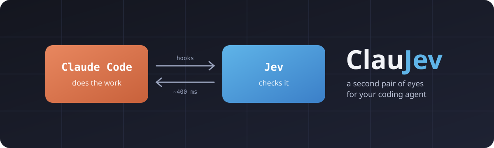
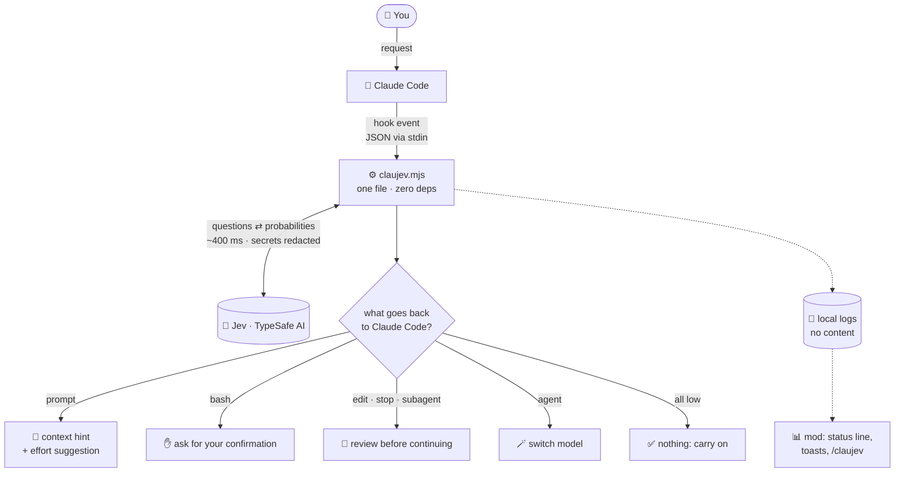
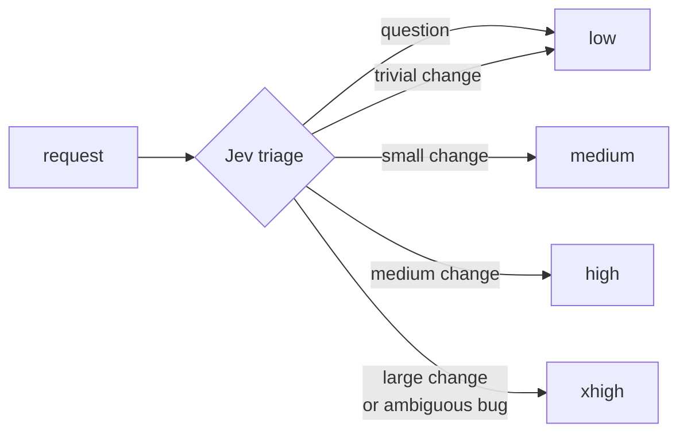
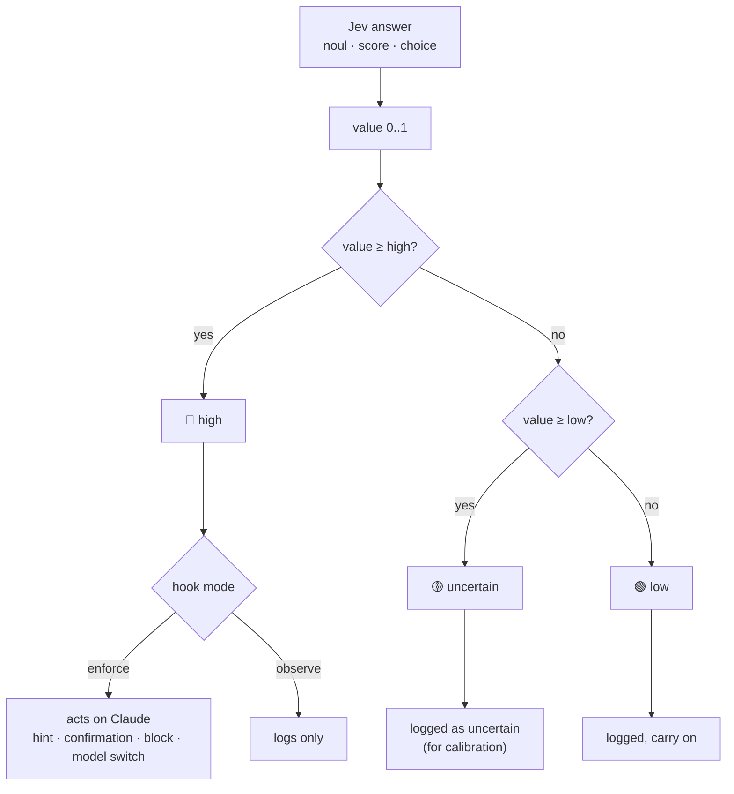
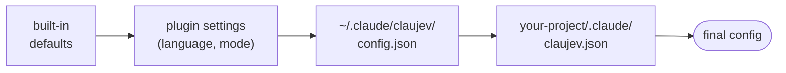

<p align="center">
  
</p>

<p align="center">
  <a href="LICENSE"></a>
  
  
  
</p>

<p align="center">
  <b>English</b> · <a href="README.pt-BR.md">Português</a>
</p>

---

**ClauJev** plugs [Jev](https://typesafe.ai), TypeSafe AI's fast judgment model, into Claude Code.
While Claude works, Jev answers short, typed questions about what is going on, such as *"is this
command destructive?"*, *"does this edit break a project rule?"* and *"was the request fully
done?"*. ClauJev turns those answers into action.

- 🧭 **Triage**: tells Claude whether a request is a question, a small change, a big one, or too vague.
- 🎚️ **Automatic effort**: picks how hard Claude should think for each request, `low` for a quick question, `xhigh` for a tangled bug.
- 🛑 **Command guard**: asks for your confirmation before destructive or credential-touching commands.
- 🔍 **Rule review**: checks every edit against rules you write in plain language.
- ✅ **Final check**: stops "done!" when the request looks incomplete, unfinished, or your tests fail.
- 🪄 **Subagent routing**: sends simple subagent tasks to a smaller, faster model.
- 🕵️ **False-claim detector**: catches subagents that report work they never did.

The core is **one Node.js file with zero dependencies**. Each check takes about **400 ms** and costs a
fraction of a cent.

> [!NOTE]
> Community project, not affiliated with TypeSafe AI or Anthropic. You need your own
> [TypeSafe AI](https://typesafe.ai) API key.

---

## Contents

- [Install](#install)
- [How it works](#how-it-works)
- [The features](#the-features)
- [Automatic effort](#automatic-effort)
- [Observe before acting: decision bands](#observe-before-acting-decision-bands)
- [Configure](#configure)
- [Calibrate with the report](#calibrate-with-the-report)
- [Real-world use](#real-world-use)
- [Privacy and safety](#privacy-and-safety)
- [FAQ](#faq)

---

## Install

In Claude Code:

```
/plugin marketplace add Civalski/claujev
/plugin install claujev@claujev
```

Claude Code asks for your **TypeSafe AI key** (kept in the system's secure storage), the
**language** (`en` or `pt`) and the **mode** (`observe` to start). Open a new session and you are done.

**Optional, the mod** (status line, toasts, automatic effort; needs a Claude Code version with mods):

```
/plugin install claujev-mod@claujev
```

**Check it works:** ask Claude *"check that ClauJev works"*. The bundled `claujev-setup` skill runs
the self-test, and it can also write your project rules and read the report for you.

<details>
<summary>Manual install, without the plugin system</summary>

```bash
git clone https://github.com/Civalski/claujev.git
cd claujev
node install.mjs
echo "TYPESAFE_API_KEY=your_key" > ~/.claude/claujev/.env
node ~/.claude/claujev/claujev.mjs selftest
```

The installer copies the script to `~/.claude/claujev/`, keeps your other hooks, backs up
`settings.json` and never overwrites your `config.json` or `.env`. It refuses to run when the plugin
is installed, so Jev never runs twice. Remove with `node install.mjs --uninstall`.
</details>

---

## How it works

Claude Code fires events (hooks) at fixed points of a conversation. ClauJev listens to six of them.
For each, it builds a small *state* with what matters at that moment, asks Jev the right questions,
and hands Claude an action, or nothing.



Three principles:

1. **Never break the session.** Any error (no key, API down, 3 s timeout) is logged and Claude carries on.
2. **Observe before acting.** Everything starts in `observe` mode: it only logs. Switch to `enforce` once the numbers look right.
3. **A signal, not a verdict.** ClauJev never deletes or reverts anything. At most it asks you, or asks Claude to double-check. A false alarm costs one sentence from Claude saying "checked, it's fine".

---

## The features

| Event | Feature | What Jev answers | What happens in `enforce` |
| --- | --- | --- | --- |
| `UserPromptSubmit` | **Triage** | kind (question, bug, feature, refactor, config), size (0–4), ambiguity, project area | a hint in Claude's context: *"just a question, don't edit"*, *"small change, go straight to it"*, *"vague, ask first"*; plus an effort suggestion |
| `PreToolUse` · Bash | **Command guard** | is the command destructive or irreversible? does it touch credentials? | Claude Code **asks for your confirmation** (it never blocks on its own) |
| `PreToolUse` · Agent | **Subagent routing** | is the task simple enough for a small model? | the subagent runs on `routeModel` (default `haiku`) |
| `PostToolUse` · Edit | **Rule review** | does this edit break rule X? (one question per rule, up to 20) | Claude gets the list of broken rules and reviews the snippet |
| `SubagentStop` | **False-claim detector** | does the report claim work that is not in the actions it ran? | the subagent must fix its report or do what is missing |
| `Stop` | **Final check** | how much of the request is done (0–4)? anything unfinished? out of scope? + your own questions | Claude does not finish: it gets the list of problems and checks again |

Details that matter:

- **Read-only shortcut.** `git status`, `ls`, `cat file` and the like pass without calling Jev. Any `;`, `|`, `&&`, `$(…)` or sensitive file (`.env`, `.ssh`, `token`) cancels the shortcut.
- **Short replies continue the request.** "yes", "go on" are joined to the previous request before triage.
- **The final check sees the real work.** It diffs the files Claude edited against the commit at the start of the turn, *and* reads the commands Claude ran (commits, pushes, releases, deploys), so a turn done entirely through the terminal is judged fairly.
- **Optional verification.** With `verify: "npm test --silent"`, the final check runs the command and a non-zero exit is enough to keep Claude working.

The exact wording of every question is in [`docs/questions.md`](docs/questions.md).

---

## Automatic effort

Claude Code lets you choose how hard the model thinks (`low` … `max`), but one setting for a whole
session is either wasteful on simple questions or too shallow on hard bugs. ClauJev's triage turns
each request into a suggestion:



- **Without the mod**, the suggestion is only logged (see it in the report).
- **With `claujev-mod`**, the `effort` setting decides: `observe` (default) shows *"effort high (suggested)"* in the status line; `on` applies it to each model request, within `min_effort` … `max_effort`.
- `max` is never chosen automatically. A request that asks for effort itself (*"ultrathink"*, *"think hard"*) is never overridden. Subagents keep their own effort.

---

## Observe before acting: decision bands

Every Jev answer becomes a value from 0 to 1 and falls into one of three bands. Only the **high** band
acts, and only when the hook is in `enforce`. The **uncertain** band exists for calibration: it shows
in the report and never interrupts Claude.



Default bands (`low` / `high`):

| Question | low | high |
| --- | --- | --- |
| request is ambiguous | 0.50 | 0.70 |
| edit breaks a rule | 0.50 | 0.85 |
| request incomplete (1 − completeness) | 0.25 | 0.40 |
| unfinished work | 0.50 | 0.85 |
| destructive command | 0.50 | 0.85 |
| command touches credentials | 0.50 | 0.70 |
| simple subagent task | 0.50 | 0.80 |
| subagent false claim | 0.50 | 0.80 |

---

## Configure

The quickest way: ask Claude *"set up ClauJev for this project"*. The `claujev-setup` skill reads your
`CLAUDE.md` and project files and proposes a `.claude/claujev.json` for you to approve.

Configuration comes in layers; the last one wins:



Objects merge key by key. `rules` and `ignoreFiles` **add up** across layers; use
`"replace_rules": true` to replace instead.

### Mode per hook

```json
{
  "hooks": { "prompt": "enforce", "bash": "enforce", "edit": "observe", "stop": "enforce", "agent": "observe", "subagent": "off" }
}
```

`observe` only logs · `enforce` acts on Claude · `off` does not call Jev at all.

### Project rules

Plain language. Each rule becomes a yes/no question about every edit.

```json
{
  "rules": [
    "Do not query the database inside a loop; fetch everything at once.",
    "Do not edit migrations that were already applied; create a new one."
  ]
}
```

Three rules are built in: no unfinished code, no secrets in code, no swallowed errors.

### Areas, context and verification

```json
{
  "areas": {
    "frontend": { "description": "UI, components, CSS", "hint": "Check the result in the browser before finishing." }
  },
  "context": ["CLAUDE.md", "docs/ARCHITECTURE.md"],
  "verify": "npm test --silent"
}
```

- **areas**: Jev classifies each request into an area and Claude gets its `hint`.
- **context**: the start of these files goes with edits and the final check, so Jev judges with your project's context.
- **verify**: command run at the final check (45 s timeout). If it fails, Claude does not finish.

### Your own questions

Ask Jev anything extra at `stop` or `edit`, with three answer types:

| Type | Answers | Becomes 0..1 as |
| --- | --- | --- |
| `noul` | yes/no with a probability | the probability of "yes" |
| `score` | a grade on a scale you define in `criteria` | the position on the scale |
| `choice` | one of several options | the sum of the probabilities of the options in `act.choices` |

```json
{
  "questions": {
    "stop": {
      "change_risk": {
        "type": "score",
        "instructions": "How likely is this change to break production?",
        "criteria": ["Trivial", "Low", "Medium", "High", "Critical"],
        "act": { "threshold": { "low": 0.5, "high": 0.75 }, "message": "high risk: ask for human review" }
      }
    }
  }
}
```

Without `act` a question is only logged, which is handy to measure before deciding. A full example
is in [`examples/claujev.json`](examples/claujev.json).

### Every option

| Key | Default | What for |
| --- | --- | --- |
| `enabled` | `true` | turns everything on/off |
| `lang` | `"en"` | `en` or `pt`: messages to Claude, questions to Jev |
| `model` | `"jev-latest"` | Jev model |
| `timeoutMs` | `3000` | max time per call |
| `hooks` | all `observe` | mode per hook |
| `thresholds` | see the table above | `low`/`high` bands per question |
| `routeModel` | `"haiku"` | model for simple subagents |
| `rules` | 3 rules | rules checked on every edit |
| `areas` | `{}` | project areas with hints |
| `context` / `contextChars` | `[]` / `4000` | context files and how much to read of each |
| `verify` / `verifyTimeoutMs` | `null` / `45000` | verification command at the final check |
| `questions` | `{}` | extra questions for `stop` and `edit` |
| `ignoreFiles` | lockfiles, images, `.min.js` | edits that are skipped |
| `checkDocs` | `false` | whether `.md`, `.txt` and `.json` edits go through rule review too |
| `maxDiffChars` | `30000` | max diff size sent at the final check |

Mod settings (in `/plugin` → ClauJev mod): `effort` (`observe`/`on`/`off`), `min_effort`, `max_effort`,
`status` (status line on/off), `lang`.

Environment variables: `TYPESAFE_API_KEY` (alternative to the plugin setting), `CLAUJEV_HOME` (another
data folder, default `~/.claude/claujev`) and `CLAUJEV_DISABLED=1` (turns it off for one session).

---

## Calibrate with the report

Ask Claude *"show me the ClauJev report"*, type `/claujev` (with the mod) or run:

```bash
node ~/.claude/plugins/cache/claujev/claujev/*/hooks/claujev.mjs report   # plugin
node ~/.claude/claujev/claujev.mjs report                                 # manual install
```

It shows, per hook: calls, errors, how often it flagged, was uncertain or acted, average latency and
cost; per question: the value distribution (median, p90, max, count per quarter of 0..1); the effort
suggestions; and the latest flagged events.

Suggested flow: keep everything in `observe` for a few days, look at the distribution, then switch on
`enforce` where the signal makes sense. If a question lives in the uncertain band, adjust its `high`
or rewrite the rule.

---

## Real-world use

Six days of daily use by the author, in a monorepo with an API, a CRM and an ERP integration:

| Hook | Calls | Acted | Avg latency | Cost |
| --- | ---: | ---: | ---: | ---: |
| bash | 1,661 | 112 | 408 ms | US$ 0.043 |
| prompt | 264 | 167 | 462 ms | US$ 0.010 |
| edit | 131 | 0 | 404 ms | US$ 0.013 |
| stop | 30 | 11 | 473 ms | US$ 0.005 |
| agent / subagent | 4 | 1 | ~360 ms | < US$ 0.001 |
| **total** | **~2,090** | | **~410 ms** | **~US$ 0.07** |

About 1.7 million input tokens for **seven US cents** (Jev's output is free). The final check asked for a
second look in 11 of 30 turns with edits. No edit was blocked by a rule, and the distribution shows the
built-in rules almost always stay below 0.1.

---

## Privacy and safety

**Sent to Jev's API** (`api.typesafe.ai`): the text of your request, the commands Claude wants to run,
the edited snippets, the turn's diff and commands, the start of `context` files and the `verify` output.
Before leaving your machine, everything goes through a filter that removes private keys, tokens
(`sk-…`, `ghp_…`, `Bearer …`) and `password=`/`token=`/`api_key=` pairs. Read
[TypeSafe AI's terms](https://typesafe.ai) before using it on confidential code.

**Kept on your machine:** logs in `~/.claude/claujev/logs/` store answers, latency and a content
*hash*, **not the content itself**. The turn state lives in `state/`. The API key lives in the
system's secure storage (plugin) or in `~/.claude/claujev/.env` with `600` permissions (manual install).

**What ClauJev never does:** delete, revert or change your files; approve a command for you (at most it
turns "allowed" into "ask the user"); hang the session (short timeouts, every error is caught and logged).

---

## FAQ

<details>
<summary><b>Does it slow Claude Code down?</b></summary>

Each check adds about 400 ms. Read-only commands don't call Jev. In practice the wait is far shorter
than Claude's own response time.
</details>

<details>
<summary><b>What if Jev is wrong?</b></summary>

Actions are reversible by design. A wrong hint is one more line of context; a wrong block at the final
check costs one sentence from Claude saying it checked. The `high` thresholds are high on purpose, and
the uncertain band never acts.
</details>

<details>
<summary><b>Does automatic effort make Claude worse on hard tasks?</b></summary>

It is off until you set the mod to `on`, it never goes above `max_effort` or below `min_effort`, and
it never touches a request where you asked for effort yourself. Start with `observe` and compare its
suggestions with what you would have picked.
</details>

<details>
<summary><b>Does Jev see the whole conversation?</b></summary>

No. It only sees the state built for each question: the request, the command or the diff. That's why
the ambiguity question explicitly says references like "this" or "that file" are normal in an ongoing
conversation.
</details>

<details>
<summary><b>How is it different from the official <code>typesafe@typesafe-ai</code> plugin?</b></summary>

The official plugin is a *skill*: it teaches Claude to write code that **uses** the Jev API in your
projects. ClauJev uses Jev to **supervise Claude itself** while it works. They live side by side.
</details>

<details>
<summary><b>How do I turn it off quickly?</b></summary>

`CLAUJEV_DISABLED=1 claude` for one session, set the mode to `off` in `/plugin`, or disable the
plugin there.
</details>

---

## Contributing

Issues and PRs are welcome. The project is small on purpose: one script for the core, one module
for the mod, no dependencies.

```bash
npm test                                # core tests (node:test, no network)
claude plugin test plugins/claujev-mod  # mod tests
claude plugin validate plugins/claujev  # manifest checks
npm run selftest                        # real call to Jev (needs a key)
```

## License

[MIT No Attribution (MIT-0)](LICENSE): use, modify and redistribute freely, including commercially,
**with no attribution or copyright notice required**.
