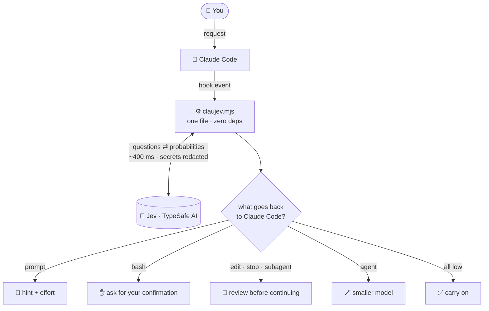
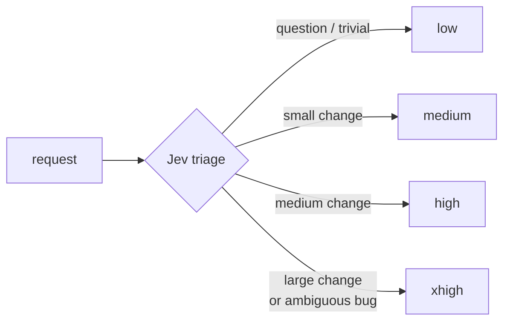

<p align="center">
  
</p>

<p align="center">
  <a href="LICENSE"></a>
  
  
</p>

<p align="center">
  <b>English</b> · <a href="README.pt-BR.md">Português</a>
</p>

---

**ClauJev** plugs [Jev](https://typesafe.ai), TypeSafe AI's fast judgment model, into Claude Code.
While Claude works, Jev answers short, typed questions such as *"is this command destructive?"* or
*"was the request fully done?"*, and ClauJev turns the answers into action:

- 🧭 **Triage**: tells Claude whether a request is a question, a small change, a big one, or too vague.
- 🎚️ **Automatic effort**: `low` for a quick question, `xhigh` for a tangled bug, chosen per request.
- 🛑 **Command guard**: asks for your confirmation before destructive or credential-touching commands.
- 🔍 **Rule review**: checks every edit against rules you write in plain language.
- ✅ **Final check**: stops "done!" when the work looks incomplete or your tests fail.
- 🪄 **Subagent routing** and 🕵️ **false-claim detector** for subagents.

About **400 ms** per check. Six days of daily use cost the author **US$ 0.07**.

> [!NOTE]
> Community project, not affiliated with TypeSafe AI or Anthropic. You need a
> [TypeSafe AI](https://typesafe.ai) API key.

## Install

In Claude Code:

```
/plugin install claujev --marketplace Civalski/claujev
```

Enter your TypeSafe AI key (the only thing the install asks) and restart Claude Code. On the first
session Claude offers a short guided setup in your language; run `/claujev:configure` to change it later.

Optional, **after** the step above: `/plugin install claujev-mod --marketplace Civalski/claujev` for the
status line and automatic effort. (Installing the mod first also installs ClauJev, but without asking
for the key: then run `/plugin configure claujev@claujev`.)

## Commands

| Command | What it does |
| --- | --- |
| `/claujev:configure` | preferences menu, in your language: language, mode, features on/off, automatic effort |
| `/claujev:claujev-setup` | project rules from your `CLAUDE.md`, self-test, report and tuning |
| `/plugin configure claujev@claujev` | your TypeSafe AI key |
| `/claujev` | today's Jev activity: calls, actions, cost, effort (needs the mod) |
| `/reload-plugins` | apply an install or update without restarting |
| `claude plugin update claujev@claujev` | update to the latest version |
| `CLAUJEV_DISABLED=1 claude` | one session without ClauJev |

You can also just ask Claude: *"check that ClauJev works"*, *"set up ClauJev for this project"*,
*"show me the ClauJev report"*.

## How it works

ClauJev listens to six Claude Code hooks. For each, it builds a small state (the request, the
command, the diff), asks Jev the right questions and hands Claude an action, or nothing.



- **Never breaks the session**: any error is logged and Claude carries on.
- **Observe before acting**: each answer falls into a low / uncertain / high band; only *high* acts, and only in `enforce`.
- **A signal, not a verdict**: ClauJev never deletes or reverts anything. A false alarm costs one sentence from Claude.
- **Sees the real work**: the final check reads the turn's diff *and* the commands Claude ran (commits, pushes, releases).

## Automatic effort



With `claujev-mod`, `observe` (default) shows the suggestion in the status line and `on` applies it,
within the limits you set. `max` is never picked automatically, subagents keep their own effort, and a
request that asks for effort itself (*"ultrathink"*) is never overridden.

## Privacy

Sent to `api.typesafe.ai`: the request, commands, edited snippets, the turn's diff and commands, after
removing keys and tokens. Kept locally in `~/.claude/claujev/`: logs with answers and a content
**hash**, never the content. The API key lives in your system's secure storage.

## Learn more

- [Configuration guide](docs/configuration.md): project rules, areas, `verify`, your own questions, every option, decision bands, the report, manual install
- [What ClauJev asks Jev](docs/questions.md): the exact questions per hook
- [Changelog](CHANGELOG.md)

<details>
<summary><b>FAQ</b></summary>

**Does it slow Claude down?** About 400 ms per check; read-only commands skip Jev entirely.

**What if Jev is wrong?** Actions are reversible by design, thresholds are high on purpose, and the
uncertain band never acts. Start in `observe` and read the report.

**Does Jev see the whole conversation?** No, only the state built for each question.

**And the official `typesafe@typesafe-ai` plugin?** That one teaches Claude to *build with* Jev.
ClauJev uses Jev to *supervise* Claude. They work side by side.
</details>

## Contributing

Issues and PRs are welcome. `npm test` runs the core tests, `claude plugin test plugins/claujev-mod`
the mod's, `npm run validate` the manifests.

## License

Created by **[Alisson Civalski](https://github.com/Civalski)**. [MIT](LICENSE): free to use, modify and
redistribute, including commercially, as long as the copyright notice is kept.
