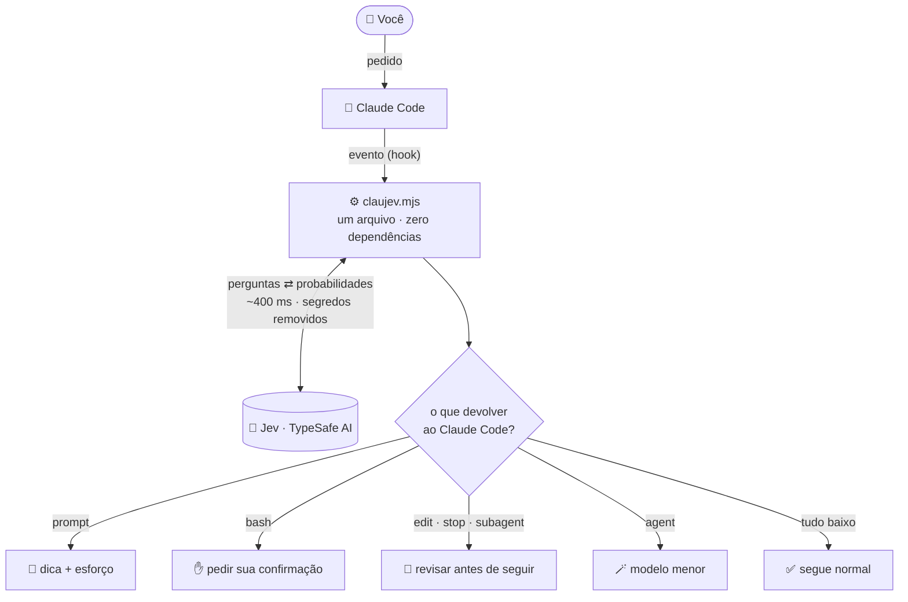
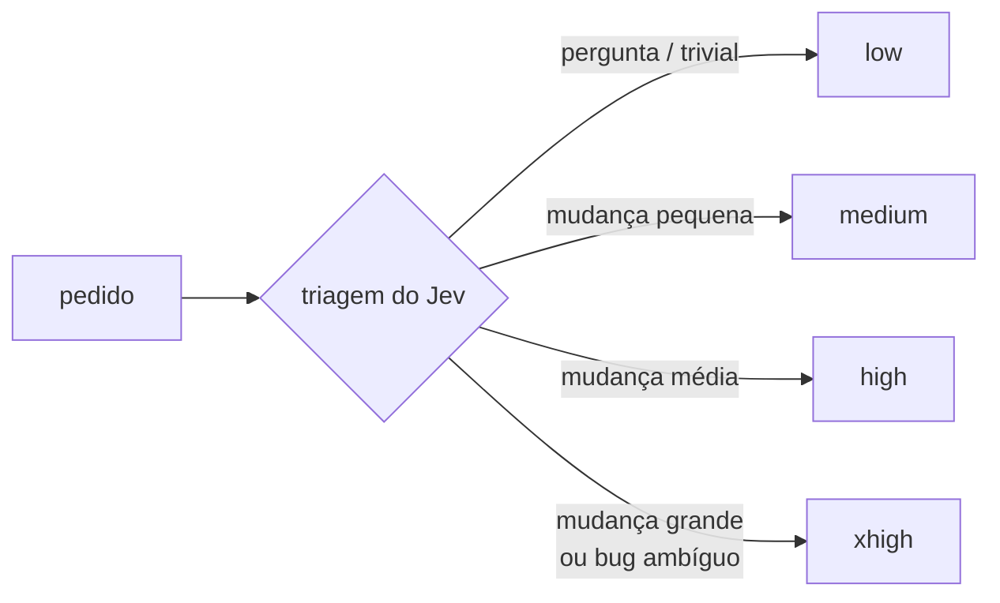

<p align="center">
  
</p>

<p align="center">
  <a href="LICENSE"></a>
  
  
</p>

<p align="center">
  <a href="README.md">English</a> · <b>Português</b>
</p>

---

**ClauJev** liga o [Jev](https://typesafe.ai), o modelo de julgamento rápido da TypeSafe AI, ao
Claude Code. Enquanto o Claude trabalha, o Jev responde perguntas curtas e objetivas, como *"este
comando é destrutivo?"* ou *"o pedido foi atendido por completo?"*, e o ClauJev transforma as
respostas em ação:

- 🧭 **Triagem**: diz ao Claude se o pedido é pergunta, mudança pequena, grande ou vago demais.
- 🎚️ **Esforço automático**: `low` numa pergunta rápida, `xhigh` num bug difícil, escolhido a cada pedido.
- 🛑 **Guarda de comandos**: pede sua confirmação antes de comandos destrutivos ou que mexem com credenciais.
- 🔍 **Revisão por regras**: confere cada edição contra regras que você escreve em português comum.
- ✅ **Conferência final**: segura o "pronto!" quando o trabalho parece incompleto ou os testes falham.
- 🪄 **Roteamento** e 🕵️ **detector de relatório falso** para subagentes.

Cerca de **400 ms** por checagem. Seis dias de uso diário custaram ao autor **US$ 0,07**.

> [!NOTE]
> Projeto da comunidade, sem vínculo oficial com a TypeSafe AI nem com a Anthropic. Você precisa de
> uma chave da [TypeSafe AI](https://typesafe.ai).

## Instalação

No Claude Code:

```
/plugin install claujev --marketplace Civalski/claujev
```

Preencha a chave da TypeSafe AI (a única opção obrigatória) e reinicie o Claude Code. Na primeira
conversa, o Claude oferece uma configuração guiada em português.

Opcional, **depois** do passo acima: `/plugin install claujev-mod --marketplace Civalski/claujev` para a
barra de status e o esforço automático. (Instalar o mod primeiro também instala o ClauJev, mas sem pedir
a chave: aí rode `/plugin configure claujev@claujev`.)

## Comandos

| Comando | O que faz |
| --- | --- |
| `/claujev:configure` | configuração guiada: pergunta suas preferências básicas e aplica |
| `/claujev:claujev-setup` | regras do projeto a partir do `CLAUDE.md`, autoteste, relatório e ajustes |
| `/plugin configure claujev@claujev` | chave, idioma, modo e liga/desliga de cada recurso |
| `/config` | liga e desliga cada recurso: Request triage, Command guard, Rule review, Final check, Subagent routing, Subagent report check |
| `/plugin configure claujev-mod@claujev` | esforço automático (`observe`/`on`/`off`), limites de esforço, barra de status |
| `/claujev` | atividade do Jev hoje: chamadas, ações, custo, esforço (precisa do mod) |
| `/reload-plugins` | aplica uma instalação ou atualização sem reiniciar |
| `claude plugin update claujev@claujev` | atualiza para a última versão |
| `CLAUJEV_DISABLED=1 claude` | uma sessão sem o ClauJev |

Você também pode só pedir ao Claude: *"confere se o ClauJev está funcionando"*, *"configura o ClauJev
para este projeto"*, *"mostra o relatório do ClauJev"*.

## Como funciona

O ClauJev escuta seis hooks do Claude Code. Em cada um, monta um pequeno estado (o pedido, o comando,
o diff), faz ao Jev as perguntas certas e devolve ao Claude uma ação ou nada.



- **Nunca quebra a sessão**: qualquer erro vai para o log e o Claude segue normalmente.
- **Observa antes de agir**: cada resposta cai numa faixa baixa / incerta / alta; só a *alta* age, e só em `enforce`.
- **Sinal, não sentença**: o ClauJev nunca apaga nem desfaz nada. Um alarme falso custa uma frase do Claude.
- **Vê o trabalho real**: a conferência final lê o diff do turno *e* os comandos que o Claude rodou (commits, push, releases).

## Esforço automático



Com o `claujev-mod`, `observe` (padrão) mostra a sugestão na barra de status e `on` aplica, dentro dos
limites que você definir. `max` nunca é escolhido sozinho, subagentes mantêm o próprio esforço, e um
pedido que já pede esforço (*"ultrathink"*, *"pense bem"*) nunca é sobrescrito.

## Privacidade

Vai para `api.typesafe.ai`: o pedido, os comandos, os trechos editados, o diff e os comandos do turno,
depois de remover chaves e tokens. Fica na sua máquina, em `~/.claude/claujev/`: logs com as respostas
e um **hash** do conteúdo, nunca o conteúdo. A chave fica no cofre seguro do sistema.

## Saiba mais

- [Guia de configuração](docs/configuracao.md): regras do projeto, áreas, `verify`, perguntas suas, todas as opções, faixas de decisão, relatório, instalação manual
- [O que o ClauJev pergunta ao Jev](docs/perguntas.md): as perguntas exatas de cada hook
- [Changelog](CHANGELOG.md)

<details>
<summary><b>Perguntas frequentes</b></summary>

**Deixa o Claude mais lento?** Cerca de 400 ms por checagem; comandos só de leitura nem chamam o Jev.

**E se o Jev errar?** As ações são reversíveis por desenho, os limites são altos de propósito, e a
faixa incerta nunca age. Comece em `observe` e leia o relatório.

**O Jev vê a conversa toda?** Não, só o estado montado para cada pergunta.

**E o plugin oficial `typesafe@typesafe-ai`?** Aquele ensina o Claude a *programar com* o Jev. O
ClauJev usa o Jev para *supervisionar* o Claude. Os dois convivem sem conflito.
</details>

## Contribuindo

Issues e PRs são bem-vindos. `npm test` roda os testes do núcleo, `claude plugin test plugins/claujev-mod`
os do mod, e `npm run validate` valida os manifestos.

## Licença

Criado por **[Alisson Civalski](https://github.com/Civalski)**. [MIT](LICENSE): livre para usar, modificar e
redistribuir, inclusive comercialmente, desde que o aviso de copyright seja mantido.
