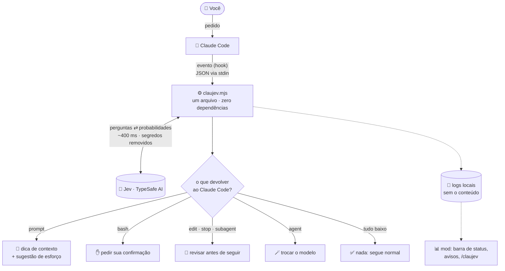
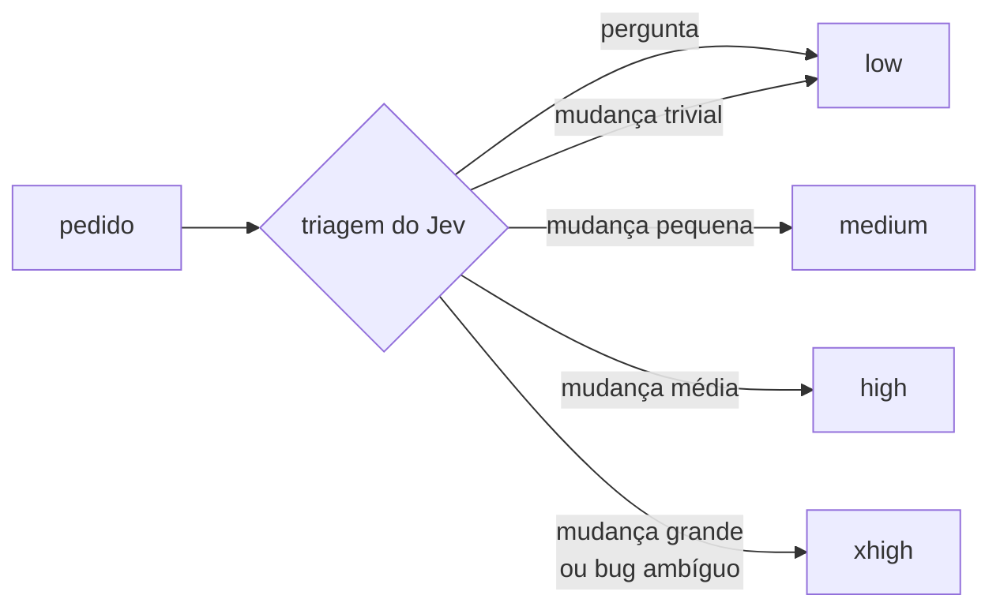
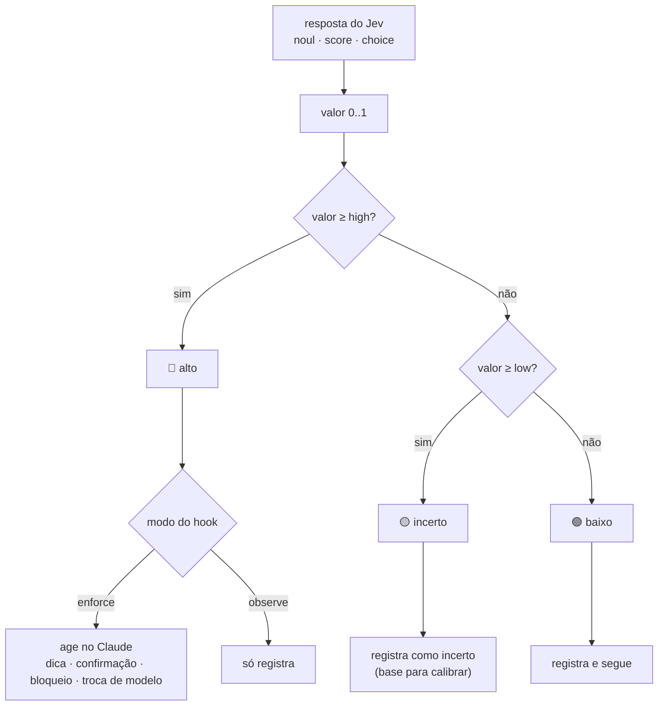
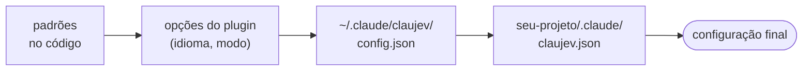

<p align="center">
  
</p>

<p align="center">
  <a href="LICENSE"></a>
  
  
  
</p>

<p align="center">
  <a href="README.md">English</a> · <b>Português</b>
</p>

---

**ClauJev** liga o [Jev](https://typesafe.ai), o modelo de julgamento rápido da TypeSafe AI, ao
Claude Code. Enquanto o Claude trabalha, o Jev responde perguntas curtas e objetivas sobre o que está
acontecendo, como *"este comando é destrutivo?"*, *"esta edição viola alguma regra do projeto?"* e
*"o pedido foi atendido por completo?"*. O ClauJev transforma essas respostas em ação.

- 🧭 **Triagem**: diz ao Claude se o pedido é pergunta, mudança pequena, grande ou vago demais.
- 🎚️ **Esforço automático**: escolhe quanto o Claude deve pensar em cada pedido, de `low` numa pergunta rápida a `xhigh` num bug difícil.
- 🛑 **Guarda de comandos**: pede sua confirmação antes de comandos destrutivos ou que mexem com credenciais.
- 🔍 **Revisão por regras**: confere cada edição contra regras que você escreve em português comum.
- ✅ **Conferência final**: segura o "pronto!" quando o pedido parece incompleto, inacabado ou os testes falham.
- 🪄 **Roteamento de subagentes**: manda tarefas simples de subagente para um modelo menor e mais rápido.
- 🕵️ **Detector de relatório falso**: pega subagentes que dizem ter feito o que não fizeram.

O núcleo é **um único arquivo de Node.js, sem dependências**. Cada checagem leva cerca de **400 ms**
e custa frações de centavo.

> [!NOTE]
> Projeto da comunidade, sem vínculo oficial com a TypeSafe AI nem com a Anthropic.
> Você precisa de uma chave própria da [TypeSafe AI](https://typesafe.ai).

---

## Sumário

- [Instalação](#instalação)
- [Como funciona](#como-funciona)
- [Os recursos](#os-recursos)
- [Esforço automático](#esforço-automático)
- [Observar antes de agir: as faixas de decisão](#observar-antes-de-agir-as-faixas-de-decisão)
- [Configuração](#configuração)
- [Calibrando com o relatório](#calibrando-com-o-relatório)
- [Uso real](#uso-real)
- [Privacidade e segurança](#privacidade-e-segurança)
- [Perguntas frequentes](#perguntas-frequentes)

---

## Instalação

No Claude Code:

```
/plugin install claujev --marketplace Civalski/claujev
```

(Em versões do Claude Code anteriores à 2.1.275: `/plugin marketplace add Civalski/claujev` e depois `/plugin install claujev@claujev`.)

O Claude Code pede a **chave da TypeSafe AI** (guardada no cofre seguro do sistema), o **idioma**
(escolha `pt`) e o **modo** (`observe` para começar). Se ele não perguntar (por exemplo, ao instalar pelo
terminal com `claude plugin install`), rode `/plugin configure claujev@claujev`. Abra uma conversa nova e pronto.

**Opcional, o mod** (barra de status, avisos e esforço automático; precisa de uma versão do Claude Code com mods):

```
/plugin install claujev-mod --marketplace Civalski/claujev
```

**Confira se funciona:** peça ao Claude *"confere se o ClauJev está funcionando"*. A skill
`claujev-setup`, que vem junto, roda o autoteste e também escreve as regras do seu projeto e lê o
relatório para você.

<details>
<summary>Instalação manual, sem o sistema de plugins</summary>

```bash
git clone https://github.com/Civalski/claujev.git
cd claujev
node install.mjs
echo "TYPESAFE_API_KEY=sua_chave" > ~/.claude/claujev/.env
node ~/.claude/claujev/claujev.mjs selftest
```

O instalador copia o script para `~/.claude/claujev/`, mantém seus outros hooks, faz backup do
`settings.json` e nunca sobrescreve seu `config.json` nem o `.env`. Ele se recusa a rodar quando o
plugin está instalado, para o Jev nunca rodar em dobro. Para remover: `node install.mjs --uninstall`.
Depois de instalar, ponha `"lang": "pt"` em `~/.claude/claujev/config.json` para as mensagens em português.
</details>

---

## Como funciona

O Claude Code dispara eventos (hooks) em pontos fixos da conversa. O ClauJev escuta seis deles. Em
cada um, monta um pequeno *estado* com o que importa naquele momento, faz ao Jev as perguntas certas
e devolve ao Claude uma ação ou nada.



Três princípios guiam o código:

1. **Nunca quebrar a sessão.** Qualquer erro (sem chave, API fora, timeout de 3 s) vai para o log e o Claude segue normalmente.
2. **Observar antes de agir.** Tudo começa em modo `observe`: só registra. Você liga `enforce` quando confia nos números.
3. **Sinal, não sentença.** O ClauJev nunca apaga nem desfaz nada. No máximo pede sua confirmação ou pede ao Claude para revisar. Um alarme falso custa uma frase do Claude dizendo "conferi, está certo".

---

## Os recursos

| Evento | Recurso | O que o Jev responde | O que acontece em `enforce` |
| --- | --- | --- | --- |
| `UserPromptSubmit` | **Triagem** | tipo (pergunta, bug, feature, refatoração, config), tamanho (0–4), ambiguidade, área do projeto | dica no contexto do Claude: *"só pergunta, não edite"*, *"mudança pequena, vá direto"*, *"pedido vago, pergunte antes"*; mais a sugestão de esforço |
| `PreToolUse` · Bash | **Guarda de comandos** | o comando é destrutivo ou irreversível? mexe com credenciais? | o Claude Code **pede a sua confirmação** (nunca bloqueia sozinho) |
| `PreToolUse` · Agent | **Roteamento de subagente** | a tarefa é simples o bastante para um modelo pequeno? | o subagente roda com o `routeModel` (padrão `haiku`) |
| `PostToolUse` · Edit | **Revisão por regras** | esta edição viola a regra X? (uma pergunta por regra, até 20) | o Claude recebe a lista de regras violadas e revisa o trecho |
| `SubagentStop` | **Detector de relatório falso** | o relatório afirma trabalho que não aparece nas ações executadas? | o subagente corrige o relatório ou faz o que falta |
| `Stop` | **Conferência final** | quanto do pedido foi atendido (0–4)? ficou algo inacabado? fora do escopo? + perguntas suas | o Claude não encerra: recebe a lista de problemas e confere de novo |

Detalhes que fazem diferença:

- **Atalho de leitura.** `git status`, `ls`, `cat arquivo` e afins passam direto, sem chamar o Jev. Qualquer `;`, `|`, `&&`, `$(…)` ou arquivo sensível (`.env`, `.ssh`, `token`) cancela o atalho.
- **Respostas curtas continuam o pedido.** "sim", "pode seguir" são somados ao pedido anterior antes da triagem.
- **A conferência final vê o trabalho real.** Ela compara os arquivos que o Claude editou com o commit do início do turno *e* lê os comandos que ele rodou (commits, push, releases, deploys). Assim, um turno feito todo pelo terminal é avaliado de forma justa.
- **Verificação opcional.** Com `verify: "npm test --silent"`, a conferência final roda o comando, e um código de saída diferente de zero já mantém o Claude trabalhando.

O texto exato de cada pergunta está em [`docs/perguntas.md`](docs/perguntas.md).

---

## Esforço automático

O Claude Code deixa escolher quanto o modelo pensa (`low` … `max`), mas uma configuração só para a
sessão inteira ou desperdiça em perguntas simples ou fica rasa em bugs difíceis. A triagem do ClauJev
transforma cada pedido numa sugestão:



- **Sem o mod**, a sugestão só é registrada (aparece no relatório).
- **Com o `claujev-mod`**, quem decide é a opção `effort`: `observe` (padrão) mostra *"esforço high (sugerido)"* na barra de status; `on` aplica a sugestão em cada chamada ao modelo, entre `min_effort` e `max_effort`.
- `max` nunca é escolhido sozinho. Um pedido que já pede esforço (*"ultrathink"*, *"pense bem"*) nunca é sobrescrito. Subagentes mantêm o próprio esforço.

---

## Observar antes de agir: as faixas de decisão

Cada resposta do Jev vira um número de 0 a 1 e cai numa de três faixas. Só a faixa **alta** age, e só
se o hook estiver em `enforce`. A faixa **incerta** existe para você calibrar: aparece no relatório,
mas nunca interrompe o Claude.



Os limites padrão (`low` / `high`):

| Pergunta | low | high |
| --- | --- | --- |
| pedido ambíguo | 0.50 | 0.70 |
| edição viola regra | 0.50 | 0.85 |
| pedido incompleto (1 − completude) | 0.25 | 0.40 |
| trabalho inacabado | 0.50 | 0.85 |
| comando destrutivo | 0.50 | 0.85 |
| comando com credenciais | 0.50 | 0.70 |
| subagente simples | 0.50 | 0.80 |
| relatório falso do subagente | 0.50 | 0.80 |

---

## Configuração

O jeito mais rápido é pedir ao Claude *"configura o ClauJev para este projeto"*. A skill
`claujev-setup` lê o seu `CLAUDE.md` e os arquivos do projeto e propõe um `.claude/claujev.json` para
você aprovar.

A configuração vem em camadas, e a última vence:



Objetos são mesclados chave a chave. `rules` e `ignoreFiles` são **somados** entre as camadas; use
`"replace_rules": true` para trocar as regras em vez de somar.

### Ligar e desligar recursos

Cada recurso tem a própria linha no `/config` (e em `/plugin configure claujev@claujev`):

| Opção | Recurso |
| --- | --- |
| Request triage | dicas + sugestão de esforço |
| Command guard | confirmação antes de comandos arriscados |
| Rule review | cada edição contra as suas regras |
| Final check | conferência antes de o Claude encerrar |
| Subagent routing | subagentes simples num modelo menor |
| Subagent report check | detector de relatório falso |

Cada uma aceita `mode` (segue a opção **Mode**, o padrão), `observe`, `enforce` ou `off`. Um recurso
desligado ali fica desligado mesmo que o `.claude/claujev.json` de um projeto tente ligá-lo; os recursos
ligados continuam ajustáveis por projeto.

### Modo de cada hook (arquivos de configuração)

```json
{
  "hooks": { "prompt": "enforce", "bash": "enforce", "edit": "observe", "stop": "enforce", "agent": "observe", "subagent": "off" }
}
```

`observe` só registra · `enforce` age no Claude · `off` nem chama o Jev.

### Regras do projeto

Escreva em linguagem natural. Cada regra vira uma pergunta sim/não sobre cada edição.

```json
{
  "lang": "pt",
  "rules": [
    "Não fazer consultas ao banco dentro de laços; busque tudo de uma vez.",
    "Não alterar arquivos de migração já aplicados; crie uma migração nova."
  ]
}
```

Três regras já vêm prontas: sem código incompleto, sem segredos no código e sem erros engolidos.

### Áreas, contexto e verificação

```json
{
  "areas": {
    "frontend": { "description": "Telas, componentes, CSS ou interface", "hint": "Confira o resultado no navegador antes de encerrar." }
  },
  "context": ["CLAUDE.md", "docs/ARQUITETURA.md"],
  "verify": "npm test --silent"
}
```

- **areas**: o Jev classifica cada pedido numa área e o Claude recebe a `hint` dela.
- **context**: o começo desses arquivos vai junto com as edições e a conferência final, para o Jev julgar com o contexto do projeto.
- **verify**: comando rodado na conferência final (timeout de 45 s). Se falhar, o Claude não encerra.

### Perguntas suas

Você pode fazer ao Jev qualquer pergunta extra no `stop` ou no `edit`, com três tipos de resposta:

| Tipo | Responde | Vira 0..1 como |
| --- | --- | --- |
| `noul` | sim/não com probabilidade | a própria probabilidade de "sim" |
| `score` | nota numa escala que você define em `criteria` | posição na escala |
| `choice` | uma entre várias opções | soma das probabilidades das opções em `act.choices` |

```json
{
  "questions": {
    "stop": {
      "change_risk": {
        "type": "score",
        "instructions": "Qual o risco desta mudança quebrar algo em produção?",
        "criteria": ["Trivial", "Baixo", "Médio", "Alto", "Crítico"],
        "act": { "threshold": { "low": 0.5, "high": 0.75 }, "message": "risco alto: peça revisão humana" }
      }
    }
  }
}
```

Sem `act`, a pergunta só é registrada no log, o que serve para medir antes de decidir. Um exemplo
completo está em [`examples/claujev.json`](examples/claujev.json).

### Todas as opções

| Chave | Padrão | Para quê |
| --- | --- | --- |
| `enabled` | `true` | liga/desliga tudo |
| `lang` | `"en"` | `en` ou `pt`: mensagens ao Claude e perguntas ao Jev |
| `model` | `"jev-latest"` | modelo do Jev |
| `timeoutMs` | `3000` | tempo máximo de cada chamada |
| `hooks` | tudo `observe` | modo de cada hook |
| `thresholds` | ver tabela acima | faixas `low`/`high` de cada pergunta |
| `routeModel` | `"haiku"` | modelo usado em subagentes simples |
| `rules` | 3 regras | regras checadas a cada edição |
| `areas` | `{}` | áreas do projeto com dicas |
| `context` / `contextChars` | `[]` / `4000` | arquivos de contexto e quanto ler de cada |
| `verify` / `verifyTimeoutMs` | `null` / `45000` | comando de verificação na conferência final |
| `questions` | `{}` | perguntas extras para `stop` e `edit` |
| `ignoreFiles` | lockfiles, imagens, `.min.js` | edições ignoradas |
| `checkDocs` | `false` | se `.md`, `.txt` e `.json` também passam pela revisão de regras |
| `maxDiffChars` | `30000` | tamanho máximo do diff enviado na conferência final |

Opções do mod (em `/plugin` → ClauJev mod): `effort` (`observe`/`on`/`off`), `min_effort`,
`max_effort`, `status` (barra de status ligada/desligada) e `lang`.

Variáveis de ambiente: `TYPESAFE_API_KEY` (alternativa à opção do plugin), `CLAUJEV_HOME` (outra pasta
de dados; o padrão é `~/.claude/claujev`) e `CLAUJEV_DISABLED=1` (desliga para uma sessão).

---

## Calibrando com o relatório

Peça ao Claude *"mostra o relatório do ClauJev"*, digite `/claujev` (com o mod) ou rode:

```bash
node ~/.claude/plugins/cache/claujev/claujev/*/hooks/claujev.mjs report   # plugin
node ~/.claude/claujev/claujev.mjs report                                 # instalação manual
```

O relatório mostra:

- **por hook:** chamadas, erros, quantas vezes sinalizou, ficou incerto ou agiu, latência média e custo;
- **por pergunta:** mediana, p90, máximo e quantas respostas caíram em cada quarto de 0..1;
- **as sugestões de esforço** e os **últimos eventos sinalizados**.

O fluxo sugerido é deixar tudo em `observe` por alguns dias, olhar a distribuição e só então ligar
`enforce` onde o sinal faz sentido. Se uma pergunta vive na faixa incerta, ajuste o `high` dela ou
reescreva a regra.

---

## Uso real

Seis dias de uso diário do autor, num monorepo com API, CRM e integração com ERP:

| Hook | Chamadas | Agiu | Latência média | Custo |
| --- | ---: | ---: | ---: | ---: |
| bash | 1.661 | 112 | 408 ms | US$ 0,043 |
| prompt | 264 | 167 | 462 ms | US$ 0,010 |
| edit | 131 | 0 | 404 ms | US$ 0,013 |
| stop | 30 | 11 | 473 ms | US$ 0,005 |
| agent / subagent | 4 | 1 | ~360 ms | < US$ 0,001 |
| **total** | **~2.090** | | **~410 ms** | **~US$ 0,07** |

Cerca de 1,7 milhão de tokens de entrada por **sete centavos de dólar** (a saída do Jev não é
cobrada). A conferência final pediu uma segunda olhada em 11 de 30 turnos com edição. Nenhuma edição
foi bloqueada por regra, e a distribuição mostra que as regras padrão ficam quase sempre abaixo de 0,1.

---

## Privacidade e segurança

**O que vai para a API do Jev** (`api.typesafe.ai`): o texto do seu pedido, os comandos que o Claude
quer rodar, os trechos editados, o diff e os comandos do turno, o começo dos arquivos de `context` e a
saída do `verify`. Antes de sair da máquina, tudo passa por um filtro que remove chaves privadas,
tokens (`sk-…`, `ghp_…`, `Bearer …`) e pares `senha=`/`token=`/`api_key=`. Leia os
[termos da TypeSafe AI](https://typesafe.ai) antes de usar em código sob sigilo.

**O que fica na sua máquina:** os logs em `~/.claude/claujev/logs/` guardam respostas, latência e um
*hash* do conteúdo, **não o conteúdo em si**. O estado do turno fica em `state/`. A chave fica no cofre
seguro do sistema (plugin) ou em `~/.claude/claujev/.env` com permissão `600` (instalação manual).

**O que o ClauJev nunca faz:** apagar, desfazer ou alterar seus arquivos; aprovar comando por você (no
máximo, transforma "aprovado" em "pergunte ao usuário"); travar a sessão (timeouts curtos, e qualquer
erro é capturado e registrado).

---

## Perguntas frequentes

<details>
<summary><b>Isso deixa o Claude Code mais lento?</b></summary>

Cada checagem soma cerca de 400 ms. Comandos de leitura pura não chamam o Jev. Na prática, a espera é
bem menor que o tempo de resposta do próprio Claude.
</details>

<details>
<summary><b>E se o Jev errar?</b></summary>

As ações são reversíveis por desenho. Uma dica errada vira uma linha a mais no contexto; um bloqueio
errado na conferência final custa uma frase do Claude dizendo que conferiu. Os limites `high` são altos
de propósito, e a faixa incerta nunca age.
</details>

<details>
<summary><b>O esforço automático piora o Claude em tarefas difíceis?</b></summary>

Ele fica desligado até você pôr o mod em `on`, nunca passa de `max_effort` nem fica abaixo de
`min_effort`, e nunca mexe num pedido em que você mesmo pediu esforço. Comece com `observe` e compare as
sugestões com o que você teria escolhido.
</details>

<details>
<summary><b>O Jev vê a conversa toda?</b></summary>

Não. Ele vê só o estado montado para cada pergunta: o pedido, o comando ou o diff. Por isso a pergunta
de ambiguidade avisa explicitamente que referências como "isso" ou "esse arquivo" são normais numa
conversa em andamento.
</details>

<details>
<summary><b>Qual a diferença para o plugin oficial <code>typesafe@typesafe-ai</code>?</b></summary>

O plugin oficial é uma *skill*: ensina o Claude a escrever código que **usa** a API do Jev nos seus
projetos. O ClauJev usa o Jev para **supervisionar o próprio Claude** enquanto ele trabalha. Os dois
convivem sem conflito.
</details>

<details>
<summary><b>Como desligo rapidamente?</b></summary>

`CLAUJEV_DISABLED=1 claude` para uma sessão, modo `off` em `/plugin`, ou desative o plugin por lá.
</details>

---

## Contribuindo

Issues e PRs são bem-vindos. O projeto é pequeno de propósito: um script para o núcleo, um módulo para
o mod, nenhuma dependência.

```bash
npm test                                # testes do núcleo (node:test, sem rede)
claude plugin test plugins/claujev-mod  # testes do mod
claude plugin validate plugins/claujev  # validação dos manifestos
npm run selftest                        # chamada real ao Jev (precisa de chave)
```

## Licença

[MIT No Attribution (MIT-0)](LICENSE): use, modifique e redistribua como quiser, inclusive em
projetos comerciais, **sem precisar citar o autor nem manter aviso de copyright**.
