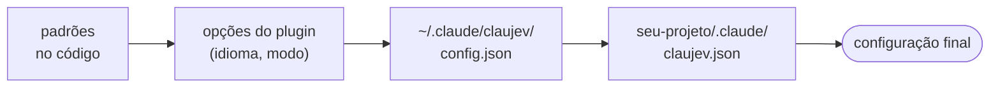
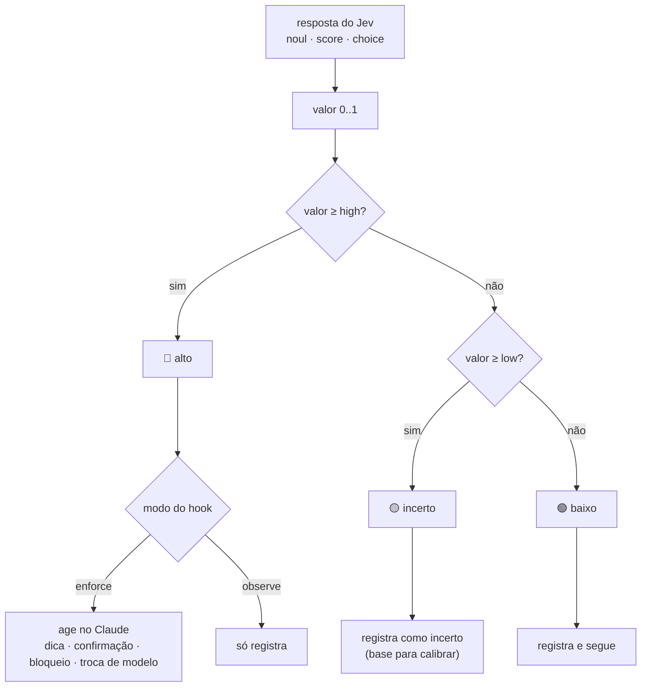

# Guia de configuração do ClauJev

Tudo o que dá para ajustar, num lugar só. Para saber o que é o ClauJev e como instalar, veja o
[README](../README.pt-BR.md). [English](configuration.md)

## Configuração

O jeito mais rápido é pedir ao Claude *"configura o ClauJev para este projeto"*. A skill
`claujev-setup` lê o seu `CLAUDE.md` e os arquivos do projeto e propõe um `.claude/claujev.json` para
você aprovar.

A configuração vem em camadas, e a última vence:



Objetos são mesclados chave a chave. `rules` e `ignoreFiles` são **somados** entre as camadas; use
`"replace_rules": true` para trocar as regras em vez de somar.

### Ligar e desligar recursos

Rode `/claujev:configure`: o Claude pergunta, em português, quais recursos manter e grava a resposta em
`~/.claude/claujev/config.json`. As mesmas chaves podem ser escritas à mão:

```json
{ "lang": "pt", "mode": "observe", "features": { "command_guard": "off", "subagent_routing": "off" } }
```

| Chave | Recurso |
| --- | --- |
| `triage` | dicas + sugestão de esforço |
| `command_guard` | confirmação antes de comandos arriscados |
| `rule_review` | cada edição contra as suas regras |
| `final_check` | conferência antes de o Claude encerrar |
| `subagent_routing` | subagentes simples num modelo menor |
| `subagent_check` | detector de relatório falso |

`mode` vale para todos os recursos (`observe`, `enforce` ou `off`); `features` ajusta um de cada vez.
Um recurso desligado (`off`) nesse arquivo global continua desligado mesmo que o `.claude/claujev.json`
de um projeto tente ligá-lo; os recursos ligados continuam ajustáveis por projeto.

### Modo de cada hook (arquivos de configuração)

```json
{
  "hooks": { "prompt": "enforce", "bash": "enforce", "edit": "observe", "stop": "enforce", "agent": "observe", "subagent": "off" }
}
```

`observe` só registra · `enforce` age no Claude · `off` nem chama o Jev.

### Regras do projeto

Escreva em linguagem natural. Cada regra vira uma pergunta sim/não sobre cada edição.

```json
{
  "lang": "pt",
  "rules": [
    "Não fazer consultas ao banco dentro de laços; busque tudo de uma vez.",
    "Não alterar arquivos de migração já aplicados; crie uma migração nova."
  ]
}
```

Três regras já vêm prontas: sem código incompleto, sem segredos no código e sem erros engolidos.

### Áreas, contexto e verificação

```json
{
  "areas": {
    "frontend": { "description": "Telas, componentes, CSS ou interface", "hint": "Confira o resultado no navegador antes de encerrar." }
  },
  "context": ["CLAUDE.md", "docs/ARQUITETURA.md"],
  "verify": "npm test --silent"
}
```

- **areas**: o Jev classifica cada pedido numa área e o Claude recebe a `hint` dela.
- **context**: o começo desses arquivos vai junto com as edições e a conferência final, para o Jev julgar com o contexto do projeto.
- **verify**: comando rodado na conferência final (timeout de 45 s). Se falhar, o Claude não encerra.

### Perguntas suas

Você pode fazer ao Jev qualquer pergunta extra no `stop` ou no `edit`, com três tipos de resposta:

| Tipo | Responde | Vira 0..1 como |
| --- | --- | --- |
| `noul` | sim/não com probabilidade | a própria probabilidade de "sim" |
| `score` | nota numa escala que você define em `criteria` | posição na escala |
| `choice` | uma entre várias opções | soma das probabilidades das opções em `act.choices` |

```json
{
  "questions": {
    "stop": {
      "change_risk": {
        "type": "score",
        "instructions": "Qual o risco desta mudança quebrar algo em produção?",
        "criteria": ["Trivial", "Baixo", "Médio", "Alto", "Crítico"],
        "act": { "threshold": { "low": 0.5, "high": 0.75 }, "message": "risco alto: peça revisão humana" }
      }
    }
  }
}
```

Sem `act`, a pergunta só é registrada no log, o que serve para medir antes de decidir. Um exemplo
completo está em [`examples/claujev.json`](../examples/claujev.json).

### Todas as opções

| Chave | Padrão | Para quê |
| --- | --- | --- |
| `enabled` | `true` | liga/desliga tudo |
| `lang` | `"en"` | `en` ou `pt`: mensagens ao Claude e perguntas ao Jev |
| `mode` | `"observe"` | vale para todos os recursos de uma vez |
| `features` | `{}` | um recurso de cada vez (chaves na tabela acima) |
| `model` | `"jev-latest"` | modelo do Jev |
| `timeoutMs` | `5000` | tempo máximo de cada chamada (um estouro é tentado de novo uma vez) |
| `hooks` | tudo `observe` | modo de cada hook |
| `thresholds` | ver tabela acima | faixas `low`/`high` de cada pergunta |
| `routeModel` | `"haiku"` | modelo usado em subagentes simples |
| `rules` | 3 regras | regras checadas a cada edição |
| `areas` | `{}` | áreas do projeto com dicas |
| `context` / `contextChars` | `[]` / `4000` | arquivos de contexto e quanto ler de cada |
| `verify` / `verifyTimeoutMs` | `null` / `45000` | comando de verificação na conferência final |
| `questions` | `{}` | perguntas extras para `stop` e `edit` |
| `ignoreFiles` | lockfiles, imagens, `.min.js` | edições ignoradas |
| `checkDocs` | `false` | se `.md`, `.txt` e `.json` também passam pela revisão de regras |
| `maxDiffChars` | `30000` | tamanho máximo do diff enviado na conferência final |

Opções do mod, no mesmo `config.json` (também escolhidas pelo `/claujev:configure`):
`"mod": { "effort": "observe" | "on" | "off", "minEffort": "low", "maxEffort": "xhigh", "status": true }`.

Variáveis de ambiente: `TYPESAFE_API_KEY` (alternativa à opção do plugin), `CLAUJEV_HOME` (outra pasta
de dados; o padrão é `~/.claude/claujev`) e `CLAUJEV_DISABLED=1` (desliga para uma sessão).


## Observar antes de agir: as faixas de decisão

Cada resposta do Jev vira um número de 0 a 1 e cai numa de três faixas. Só a faixa **alta** age, e só
se o hook estiver em `enforce`. A faixa **incerta** existe para você calibrar: aparece no relatório,
mas nunca interrompe o Claude.



Os limites padrão (`low` / `high`):

| Pergunta | low | high |
| --- | --- | --- |
| pedido ambíguo | 0.50 | 0.70 |
| edição viola regra | 0.50 | 0.85 |
| pedido incompleto (1 − completude) | 0.25 | 0.40 |
| trabalho inacabado | 0.50 | 0.85 |
| comando destrutivo | 0.50 | 0.85 |
| comando com credenciais | 0.50 | 0.70 |
| subagente simples | 0.50 | 0.80 |
| relatório falso do subagente | 0.50 | 0.80 |


## Calibrando com o relatório

Peça ao Claude *"mostra o relatório do ClauJev"*, digite `/claujev` (com o mod) ou rode:

```bash
node ~/.claude/plugins/cache/claujev/claujev/*/hooks/claujev.mjs report   # plugin
node ~/.claude/claujev/claujev.mjs report                                 # instalação manual
```

O relatório mostra:

- **por hook:** chamadas, erros, quantas vezes sinalizou, ficou incerto ou agiu, latência média e custo;
- **por pergunta:** mediana, p90, máximo e quantas respostas caíram em cada quarto de 0..1;
- **as sugestões de esforço** e os **últimos eventos sinalizados**.

O fluxo sugerido é deixar tudo em `observe` por alguns dias, olhar a distribuição e só então ligar
`enforce` onde o sinal faz sentido. Se uma pergunta vive na faixa incerta, ajuste o `high` dela ou
reescreva a regra.


## Privacidade e segurança

**O que vai para a API do Jev** (`api.typesafe.ai`): o texto do seu pedido, os comandos que o Claude
quer rodar, os trechos editados, o diff e os comandos do turno, o começo dos arquivos de `context` e a
saída do `verify`. Antes de sair da máquina, tudo passa por um filtro que remove chaves privadas,
tokens (`sk-…`, `ghp_…`, `Bearer …`) e pares `senha=`/`token=`/`api_key=`. Leia os
[termos da TypeSafe AI](https://typesafe.ai) antes de usar em código sob sigilo.

**O que fica na sua máquina:** os logs em `~/.claude/claujev/logs/` guardam respostas, latência e um
*hash* do conteúdo, **não o conteúdo em si**. O estado do turno fica em `state/`. A chave fica no cofre
seguro do sistema (plugin) ou em `~/.claude/claujev/.env` com permissão `600` (instalação manual).

**O que o ClauJev nunca faz:** apagar, desfazer ou alterar seus arquivos; aprovar comando por você (no
máximo, transforma "aprovado" em "pergunte ao usuário"); travar a sessão (timeouts curtos, e qualquer
erro é capturado e registrado).


## Instalação manual

```bash
git clone https://github.com/Civalski/claujev.git
cd claujev
node install.mjs
echo "TYPESAFE_API_KEY=sua_chave" > ~/.claude/claujev/.env
node ~/.claude/claujev/claujev.mjs selftest
```

O instalador copia o script para `~/.claude/claujev/`, mantém seus outros hooks, faz backup do
`settings.json` e nunca sobrescreve seu `config.json` nem o `.env`. Ele se recusa a rodar quando o
plugin está instalado, para o Jev nunca rodar em dobro. Para remover: `node install.mjs --uninstall`.
Depois de instalar, rode `/claujev:configure` (ou ponha `"lang": "pt"` em `~/.claude/claujev/config.json`) para as mensagens em português.
