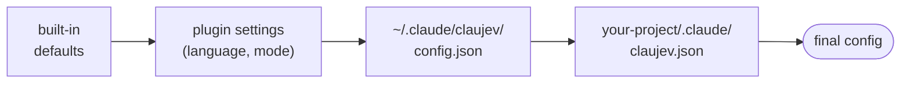
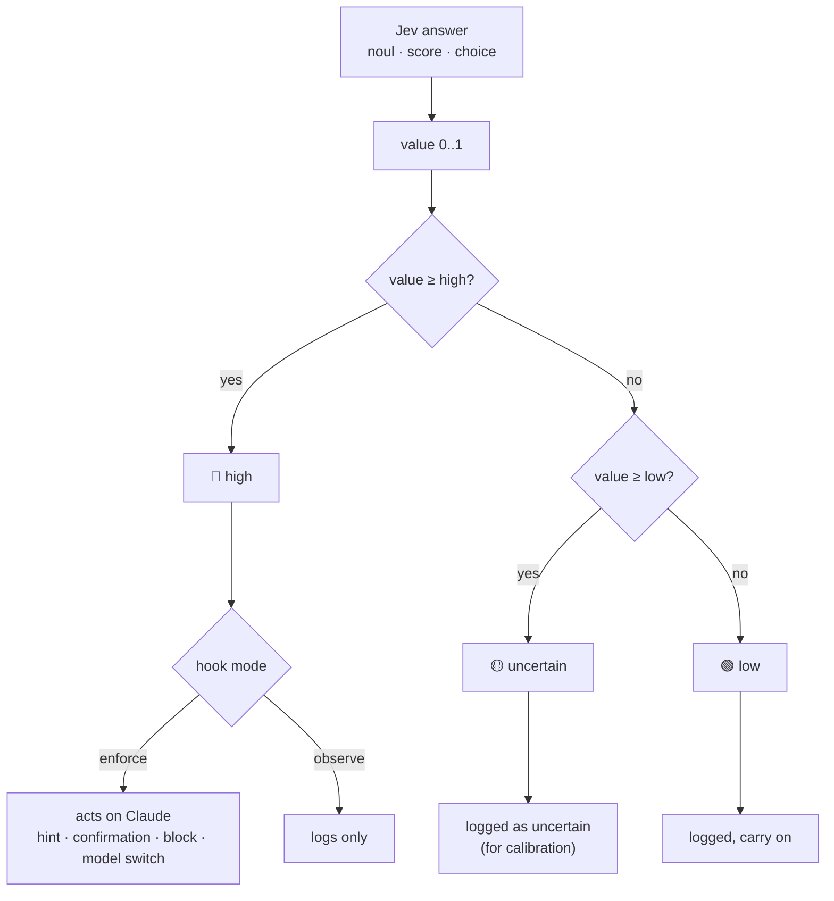

# ClauJev configuration guide

Everything you can tune, in one place. For what ClauJev is and how to install it, see the
[README](../README.md). [Português](configuracao.md)

## Configure

The quickest way: ask Claude *"set up ClauJev for this project"*. The `claujev-setup` skill reads your
`CLAUDE.md` and project files and proposes a `.claude/claujev.json` for you to approve.

Configuration comes in layers; the last one wins:



Objects merge key by key. `rules` and `ignoreFiles` **add up** across layers; use
`"replace_rules": true` to replace instead.

### Turn features on and off

Run `/claujev:configure`: Claude asks, in your language, which features to keep and saves the answer
in `~/.claude/claujev/config.json`. The same keys can be written by hand:

```json
{ "lang": "en", "mode": "observe", "features": { "command_guard": "off", "subagent_routing": "off" } }
```

| Key | Feature |
| --- | --- |
| `triage` | hints + effort suggestion |
| `command_guard` | confirmation before risky commands |
| `rule_review` | every edit against your rules |
| `final_check` | completeness check before Claude finishes |
| `subagent_routing` | simple subagents on a smaller model |
| `subagent_check` | false-claim detector |

`mode` sets every feature (`observe`, `enforce` or `off`); `features` sets one at a time. A feature
switched `off` in this global file stays off even if a project's `.claude/claujev.json` turns it on;
features left on can still be tuned per project.

### Mode per hook (config files)

```json
{
  "hooks": { "prompt": "enforce", "bash": "enforce", "edit": "observe", "stop": "enforce", "agent": "observe", "subagent": "off" }
}
```

`observe` only logs · `enforce` acts on Claude · `off` does not call Jev at all.

### Project rules

Plain language. Each rule becomes a yes/no question about every edit.

```json
{
  "rules": [
    "Do not query the database inside a loop; fetch everything at once.",
    "Do not edit migrations that were already applied; create a new one."
  ]
}
```

Three rules are built in: no unfinished code, no secrets in code, no swallowed errors.

### Areas, context and verification

```json
{
  "areas": {
    "frontend": { "description": "UI, components, CSS", "hint": "Check the result in the browser before finishing." }
  },
  "context": ["CLAUDE.md", "docs/ARCHITECTURE.md"],
  "verify": "npm test --silent"
}
```

- **areas**: Jev classifies each request into an area and Claude gets its `hint`.
- **context**: the start of these files goes with edits and the final check, so Jev judges with your project's context.
- **verify**: command run at the final check (45 s timeout). If it fails, Claude does not finish.

### Your own questions

Ask Jev anything extra at `stop` or `edit`, with three answer types:

| Type | Answers | Becomes 0..1 as |
| --- | --- | --- |
| `noul` | yes/no with a probability | the probability of "yes" |
| `score` | a grade on a scale you define in `criteria` | the position on the scale |
| `choice` | one of several options | the sum of the probabilities of the options in `act.choices` |

```json
{
  "questions": {
    "stop": {
      "change_risk": {
        "type": "score",
        "instructions": "How likely is this change to break production?",
        "criteria": ["Trivial", "Low", "Medium", "High", "Critical"],
        "act": { "threshold": { "low": 0.5, "high": 0.75 }, "message": "high risk: ask for human review" }
      }
    }
  }
}
```

Without `act` a question is only logged, which is handy to measure before deciding. A full example
is in [`examples/claujev.json`](../examples/claujev.json).

### Every option

| Key | Default | What for |
| --- | --- | --- |
| `enabled` | `true` | turns everything on/off |
| `lang` | `"en"` | `en` or `pt`: messages to Claude, questions to Jev |
| `mode` | `"observe"` | sets every feature at once |
| `features` | `{}` | one feature at a time (keys in the table above) |
| `model` | `"jev-latest"` | Jev model |
| `timeoutMs` | `3000` | max time per call |
| `hooks` | all `observe` | mode per hook |
| `thresholds` | see the table above | `low`/`high` bands per question |
| `routeModel` | `"haiku"` | model for simple subagents |
| `rules` | 3 rules | rules checked on every edit |
| `areas` | `{}` | project areas with hints |
| `context` / `contextChars` | `[]` / `4000` | context files and how much to read of each |
| `verify` / `verifyTimeoutMs` | `null` / `45000` | verification command at the final check |
| `questions` | `{}` | extra questions for `stop` and `edit` |
| `ignoreFiles` | lockfiles, images, `.min.js` | edits that are skipped |
| `checkDocs` | `false` | whether `.md`, `.txt` and `.json` edits go through rule review too |
| `maxDiffChars` | `30000` | max diff size sent at the final check |

Mod settings, in the same `config.json` (also chosen by `/claujev:configure`):
`"mod": { "effort": "observe" | "on" | "off", "minEffort": "low", "maxEffort": "xhigh", "status": true }`.

Environment variables: `TYPESAFE_API_KEY` (alternative to the plugin setting), `CLAUJEV_HOME` (another
data folder, default `~/.claude/claujev`) and `CLAUJEV_DISABLED=1` (turns it off for one session).


## Observe before acting: decision bands

Every Jev answer becomes a value from 0 to 1 and falls into one of three bands. Only the **high** band
acts, and only when the hook is in `enforce`. The **uncertain** band exists for calibration: it shows
in the report and never interrupts Claude.



Default bands (`low` / `high`):

| Question | low | high |
| --- | --- | --- |
| request is ambiguous | 0.50 | 0.70 |
| edit breaks a rule | 0.50 | 0.85 |
| request incomplete (1 − completeness) | 0.25 | 0.40 |
| unfinished work | 0.50 | 0.85 |
| destructive command | 0.50 | 0.85 |
| command touches credentials | 0.50 | 0.70 |
| simple subagent task | 0.50 | 0.80 |
| subagent false claim | 0.50 | 0.80 |


## Calibrate with the report

Ask Claude *"show me the ClauJev report"*, type `/claujev` (with the mod) or run:

```bash
node ~/.claude/plugins/cache/claujev/claujev/*/hooks/claujev.mjs report   # plugin
node ~/.claude/claujev/claujev.mjs report                                 # manual install
```

It shows, per hook: calls, errors, how often it flagged, was uncertain or acted, average latency and
cost; per question: the value distribution (median, p90, max, count per quarter of 0..1); the effort
suggestions; and the latest flagged events.

Suggested flow: keep everything in `observe` for a few days, look at the distribution, then switch on
`enforce` where the signal makes sense. If a question lives in the uncertain band, adjust its `high`
or rewrite the rule.


## Privacy and safety

**Sent to Jev's API** (`api.typesafe.ai`): the text of your request, the commands Claude wants to run,
the edited snippets, the turn's diff and commands, the start of `context` files and the `verify` output.
Before leaving your machine, everything goes through a filter that removes private keys, tokens
(`sk-…`, `ghp_…`, `Bearer …`) and `password=`/`token=`/`api_key=` pairs. Read
[TypeSafe AI's terms](https://typesafe.ai) before using it on confidential code.

**Kept on your machine:** logs in `~/.claude/claujev/logs/` store answers, latency and a content
*hash*, **not the content itself**. The turn state lives in `state/`. The API key lives in the
system's secure storage (plugin) or in `~/.claude/claujev/.env` with `600` permissions (manual install).

**What ClauJev never does:** delete, revert or change your files; approve a command for you (at most it
turns "allowed" into "ask the user"); hang the session (short timeouts, every error is caught and logged).


## Manual install

```bash
git clone https://github.com/Civalski/claujev.git
cd claujev
node install.mjs
echo "TYPESAFE_API_KEY=your_key" > ~/.claude/claujev/.env
node ~/.claude/claujev/claujev.mjs selftest
```

The installer copies the script to `~/.claude/claujev/`, keeps your other hooks, backs up
`settings.json` and never overwrites your `config.json` or `.env`. It refuses to run when the plugin
is installed, so Jev never runs twice. Remove with `node install.mjs --uninstall`.
