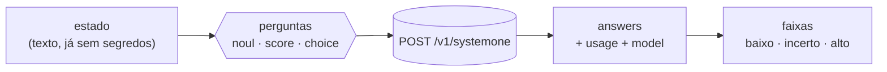

# O que o ClauJev pergunta ao Jev

Cada hook monta um **estado** (o texto que o Jev lê) e uma lista de **perguntas tipadas**.
Esta página resume as duas coisas para cada hook. O texto exato está em
[`hooks/claujev.mjs`](../hooks/claujev.mjs). Antes de qualquer envio, o estado passa pela
função `redact()`, que remove chaves e tokens.

Tipos de pergunta da API System One:

| Tipo | A resposta traz | Como o ClauJev usa |
| --- | --- | --- |
| `noul` | `noul`: probabilidade de "sim" (0..1) | direto como valor |
| `score` | `score` e `legend` (os níveis) | normalizado para 0..1 |
| `choice` | `choice`, `confidence` e `probabilities` | a opção escolhida, ou a soma de algumas opções |

---

## `prompt` · UserPromptSubmit

**Estado:** o pedido do usuário (até 6.000 caracteres). Mensagens com menos de 40 caracteres
são somadas ao pedido anterior. Comandos `/` e mensagens com menos de 15 caracteres não são
enviados.

| Pergunta | Tipo | Opções |
| --- | --- | --- |
| `task_type`: que tipo de trabalho o pedido exige? | choice | pergunta · bug · feature · refatoracao · config · outro |
| `scope`: qual o tamanho provável da mudança? | score | nenhuma · trivial · pequena · média · grande |
| `ambiguous`: o pedido continua vago mesmo para quem tem o histórico? | noul | — |
| `area`: a que área do projeto o pedido se refere? *(só se houver `areas`)* | choice | suas áreas + nenhuma |

**Dicas possíveis:** só pergunta (confiança ≥ 0,6) → não editar; escopo ≤ 0,5 → ir direto,
sem subagentes; escopo ≥ 0,85 → planejar antes; ambíguo alto → perguntar antes; `hint` da área
(confiança ≥ 0,5).

## `bash` · PreToolUse (Bash, PowerShell)

**Estado:** o comando (até 4.000 caracteres). Comandos de leitura pura não são enviados.

| Pergunta | Tipo |
| --- | --- |
| `side_effects`: o comando é destrutivo ou difícil de desfazer? | noul |
| `credentials`: o comando lê, mostra, copia ou envia credenciais? | noul |

**Ação:** `permissionDecision: "ask"`, ou seja, o Claude Code pede a sua confirmação.

## `agent` · PreToolUse (Agent)

**Estado:** tipo do subagente, descrição e prompt (até 6.000 caracteres). Não é chamado se o
Claude já escolheu um modelo.

| Pergunta | Tipo |
| --- | --- |
| `simple`: um modelo pequeno e rápido faz bem esta tarefa? | noul |

**Ação:** `updatedInput.model = routeModel`. Só o modelo muda; o nível de esforço não é alterado.

## `edit` · PostToolUse (Edit, Write, MultiEdit, NotebookEdit)

**Estado:** começo dos arquivos de `context`, o caminho do arquivo e o trecho antigo e o novo
(até 12.000 caracteres). Lockfiles, imagens e, por padrão, `.md`/`.txt`/`.json` são pulados.

| Pergunta | Tipo |
| --- | --- |
| `r0`…`r19`: esta alteração viola a regra *N*? | noul |
| `p_<id>`: suas perguntas de `questions.edit` | qualquer |

**Ação:** `decision: "block"` com a lista de regras violadas. O Claude revisa o trecho ou explica
por que é falso positivo.

## `subagent` · SubagentStop

**Estado:** a lista de ações reais do subagente, lida do transcript (ferramenta + alvo), e o
relatório final dele. Só é chamado se o subagente editou algo ou rodou comandos.

| Pergunta | Tipo |
| --- | --- |
| `false_claims`: o relatório afirma trabalho que não aparece nas ações? | noul |

**Ação:** `decision: "block"`, e o subagente corrige o relatório ou faz o que falta.

## `stop` · Stop

**Estado:** contexto do projeto, o pedido, a lista de arquivos editados, o diff desde o commit
do início do turno (até 30.000 caracteres) e o resultado do `verify`. Só é chamado se houve
edição no turno.

| Pergunta | Tipo |
| --- | --- |
| `completeness`: o quanto as alterações atendem ao pedido? | score (0–4) |
| `unfinished`: ficou algo inacabado? | noul |
| `out_of_scope`: mexeu em algo que não foi pedido? *(só registra)* | noul |
| `p_<id>`: suas perguntas de `questions.stop` | qualquer |

**Ação:** `decision: "block"` com os problemas encontrados. Quando o Claude Code avisa que já
está continuando por causa de um hook (`stop_hook_active`), o ClauJev não bloqueia de novo,
então não há laço infinito.
