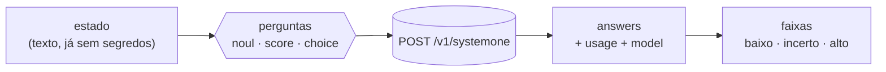

# O que o ClauJev pergunta ao Jev

Cada hook monta um **estado** (o texto que o Jev lê) e uma lista de **perguntas tipadas**.
Esta página resume as duas coisas para cada hook. O texto exato está em
[`plugins/claujev/hooks/claujev.mjs`](../plugins/claujev/hooks/claujev.mjs), em inglês e em português
(opção `lang`). Os ids das perguntas e das opções são os mesmos nos dois idiomas. Antes de qualquer
envio, o estado passa pela função `redact()`, que remove chaves e tokens.

Tipos de pergunta da API System One:

| Tipo | A resposta traz | Como o ClauJev usa |
| --- | --- | --- |
| `noul` | `noul`: probabilidade de "sim" (0..1) | direto como valor |
| `score` | `score` e `legend` (os níveis) | normalizado para 0..1 |
| `choice` | `choice`, `confidence` e `probabilities` | a opção escolhida, ou a soma de algumas opções |

---

## `prompt` · UserPromptSubmit

**Estado:** o pedido do usuário (até 6.000 caracteres). Mensagens com menos de 40 caracteres
são somadas ao pedido anterior; as maiores levam o pedido anterior como contexto (até 1.500
caracteres). Comandos `/`, mensagens com menos de 15 caracteres e mensagens que o próprio Claude Code
injeta (`<task-notification>`, `<local-command-…>` etc.) não são enviados.

| Pergunta | Tipo | Opções |
| --- | --- | --- |
| `task_type`: que tipo de trabalho o pedido exige? | choice | question · bug · feature · refactor · config · other |
| `scope`: qual o tamanho provável da mudança? | score | nenhuma · trivial · pequena · média · grande |
| `depth`: independente de código, quanta investigação e raciocínio o pedido exige? | score | resposta direta · conferir uma coisa · cruzar algumas fontes · investigar vários lugares · análise profunda |
| `ambiguous`: o pedido continua vago mesmo para quem tem o histórico? | noul | — |
| `area`: a que área do projeto o pedido se refere? *(só se houver `areas`)* | choice | suas áreas + none |

**Dicas:** ambíguo alto → perguntar antes; `hint` da área (confiança ≥ 0,5). Com `sizeHints: true`
(desligado por padrão), também: só pergunta (confiança ≥ 0,6) → não editar; tarefa de código com
escopo ≤ 0,5 → ir direto, sem subagentes; escopo ≥ 0,85 → planejar antes.

**Sugestão de esforço** (gravada no estado da sessão e aplicada pelo `claujev-mod`, se instalado): vale
o maior de dois níveis. Tamanho: ≤ 0,3 → `low`, ≤ 0,6 → `medium`, ≤ 0,85 → `high`, maior → `xhigh`.
Profundidade: ≤ 0,45 → `low`, ≤ 0,8 → `medium`, ≤ 0,95 → `high`, maior → `xhigh`. Uma pergunta
(confiança ≥ 0,6) usa só a profundidade e para em `high`. Um pedido com "ultrathink", "pense bem" ou
parecido fica marcado como `explicitEffort`, e o mod não mexe nele. O mod grava cada resposta à
pergunta de esforço em `logs/effort-<dia>-<sessão>.jsonl`.

## `bash` · PreToolUse (Bash, PowerShell)

**Estado:** o comando (até 4.000 caracteres). Comandos de leitura pura não são enviados, inclusive
encadeados como `cd repo && git status | head` quando todas as partes são leitura (sem
redirecionamento, substituição ou arquivo sensível). A guarda só pergunta em mudança crítica e difícil
de desfazer; push, merge, `branch -D`, `reset --hard` e deploy de rotina ficam com as permissões do
próprio Claude Code. O que uma regra fixa resolve pede confirmação sem chamar o Jev: force push na
`main`/`master`, `npm publish`, `terraform destroy` (ou `apply -destroy`), `kubectl delete`,
`gh repo delete`, `aws s3 rb`, `aws rds delete-db-instance/cluster`, `supabase db reset --linked`,
`DROP`/`TRUNCATE` (registrado com `local: true`).

| Pergunta | Tipo |
| --- | --- |
| `side_effects`: é uma mudança crítica em produção, difícil de desfazer (apagar dados ou recursos de produção, destruir infraestrutura, reescrever a branch principal)? Push, merge, deploy pelo workflow, migration de schema e homologação não são | noul |
| `credentials`: o comando vaza uma credencial para fora da máquina (commit, issue, serviço de terceiros) ou imprime um segredo inteiro? Copiar um `.env` entre pastas locais ou carregá-lo para uma ferramenta local não é vazamento | noul |

**Ação:** `permissionDecision: "ask"`, ou seja, o Claude Code pede a sua confirmação.

## `agent` · PreToolUse (Agent)

**Estado:** tipo do subagente, descrição e prompt (até 6.000 caracteres). Não é chamado se o
Claude já escolheu um modelo.

| Pergunta | Tipo |
| --- | --- |
| `simple`: um modelo pequeno e rápido faz bem esta tarefa? | noul |

**Ação:** `updatedInput.model = routeModel`. Só o modelo muda; o nível de esforço não é alterado.

## `edit` · PostToolUse (Edit, Write, MultiEdit, NotebookEdit)

**Estado:** começo dos arquivos de `context`, o caminho do arquivo e o trecho antigo e o novo
(até 12.000 caracteres). Lockfiles, imagens e, por padrão, `.md`/`.txt`/`.json` são pulados.

| Pergunta | Tipo |
| --- | --- |
| `r0`…`r19`: esta alteração viola a regra *N*? | noul |
| `p_<id>`: suas perguntas de `questions.edit` | qualquer |

**Ação:** `decision: "block"` com a lista de regras violadas. O Claude revisa o trecho ou explica
por que é falso positivo.

## `subagent` · SubagentStop

**Estado:** a lista de ações reais do subagente, lida do transcript (ferramenta + alvo), e o
relatório final dele. Só é chamado se o subagente editou algo ou rodou comandos.

| Pergunta | Tipo |
| --- | --- |
| `false_claims`: o relatório afirma trabalho que não aparece nas ações? | noul |

**Ação:** `decision: "block"`, e o subagente corrige o relatório ou faz o que falta.

## `stop` · Stop

**Estado:** contexto do projeto, o pedido, a lista de arquivos editados, o diff desde o commit
do início do turno (até 30.000 caracteres), os comandos que o Claude rodou no turno (lidos do
transcript; os com efeito mais detalhados, e o fim do turno quando a lista é longa), o resultado do
`verify` e a resposta final do Claude (até 3.000 caracteres). É chamado quando o turno teve edição ou um comando com efeito
(`git commit`/`push`/`tag`, `gh … create`, `npm publish`, deploy, `curl -X POST` etc.). Um comando do
shell que escreve arquivo (`sed -i`, `python … open('w')`, `cat > … <<EOF`, redirecionamento) também
conta: o diff e os arquivos novos do turno são lidos do git, inclusive num repositório em que o comando
entrou com `cd`. Turnos sem mudança ficam registrados como pulados.

**Depois de um bloqueio:** o Stop seguinte registra `followUp` (chamadas de ferramenta depois do
bloqueio e quantas mudaram algo), sem chamar o Jev. O `report` soma: mudou algo = o bloqueio ajudou; só
explicou = provável alarme falso.

| Pergunta | Tipo |
| --- | --- |
| `completeness`: considerando arquivos, comandos e a resposta final, quanto do pedido foi feito? | score (0–4) |
| `unfinished`: ficou algo inacabado? | noul |
| `out_of_scope`: mexeu em algo que não foi pedido? *(só registra)* | noul |
| `p_<id>`: suas perguntas de `questions.stop` | qualquer |

**Ação:** um aviso para você (`systemMessage`) com os problemas encontrados. Só bloqueia
(`decision: "block"`) quando o comando `verify` falha, ou sempre que houver problema com
`stopBlocks: true`. Quando o Claude Code avisa que já
está continuando por causa de um hook (`stop_hook_active`), o ClauJev não bloqueia de novo,
então não há laço infinito.
