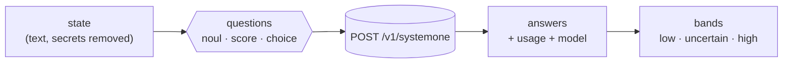

# What ClauJev asks Jev

Each hook builds a **state** (the text Jev reads) and a list of **typed questions**. This page sums
up both for every hook. The exact wording is in
[`plugins/claujev/hooks/claujev.mjs`](../plugins/claujev/hooks/claujev.mjs), in English and Portuguese
(`lang` option). Question and choice ids are the same in both languages. Before anything is sent,
the state goes through `redact()`, which removes keys and tokens.

[Português](perguntas.md)

Question types of the System One API:

| Type | The answer carries | How ClauJev uses it |
| --- | --- | --- |
| `noul` | `noul`: probability of "yes" (0..1) | as the value |
| `score` | `score` and `legend` (the levels) | normalised to 0..1 |
| `choice` | `choice`, `confidence` and `probabilities` | the chosen option, or the sum of some options |

---

## `prompt` · UserPromptSubmit

**State:** the user's request (up to 6,000 characters). Messages under 40 characters are joined to the
previous request. Slash commands and messages under 15 characters are not sent.

| Question | Type | Options |
| --- | --- | --- |
| `task_type`: what kind of work does the request need? | choice | question · bug · feature · refactor · config · other |
| `scope`: how large is the change likely to be? | score | none · trivial · small · medium · large |
| `ambiguous`: is the request still vague for someone who has the history? | noul | — |
| `area`: which project area is it about? *(only with `areas`)* | choice | your areas + none |

**Possible hints:** question (confidence ≥ 0.6) → don't edit; scope ≤ 0.5 → go straight to it, no
subagents; scope ≥ 0.85 → plan first; high ambiguity → ask first; the area's `hint` (confidence ≥ 0.5).

**Effort suggestion** (stored in the session state and applied by `claujev-mod` when installed):
question (confidence ≥ 0.6) → `low`; scope ≤ 0.3 → `low`; ≤ 0.6 → `medium`; ≤ 0.85 → `high`; above →
`xhigh`. A bug with ambiguity ≥ 0.7 goes one level up, at most `xhigh`. A request with "ultrathink",
"think hard" or similar is marked `explicitEffort`, and the mod leaves it alone.

## `bash` · PreToolUse (Bash, PowerShell)

**State:** the command (up to 4,000 characters). Plain read-only commands are not sent.

| Question | Type |
| --- | --- |
| `side_effects`: is the command destructive or hard to undo? | noul |
| `credentials`: does it read, print, copy or send credentials? | noul |

**Action:** `permissionDecision: "ask"`, so Claude Code asks for your confirmation.

## `agent` · PreToolUse (Agent)

**State:** subagent type, description and prompt (up to 6,000 characters). Skipped when Claude already
chose a model.

| Question | Type |
| --- | --- |
| `simple`: can a small, fast model do this task well? | noul |

**Action:** `updatedInput.model = routeModel`. Only the model changes.

## `edit` · PostToolUse (Edit, Write, MultiEdit, NotebookEdit)

**State:** the start of the `context` files, the file path and the old and new snippet (up to 12,000
characters). Lockfiles, images and, by default, `.md`/`.txt`/`.json` are skipped.

| Question | Type |
| --- | --- |
| `r0`…`r19`: does this change break rule *N*? | noul |
| `p_<id>`: your `questions.edit` | any |

**Action:** `decision: "block"` with the list of broken rules. Claude reviews the snippet or explains
why it is a false positive.

## `subagent` · SubagentStop

**State:** the subagent's real actions, read from its transcript (tool + target), and its final report.
Only called when the subagent edited something or ran commands.

| Question | Type |
| --- | --- |
| `false_claims`: does the report claim work that is not in the actions? | noul |

**Action:** `decision: "block"`; the subagent fixes its report or does what is missing.

## `stop` · Stop

**State:** project context, the request, the edited files, the diff since the commit at the start of
the turn (up to 30,000 characters), the commands Claude ran in the turn (read from the transcript) and
the `verify` result. Called when the turn had an edit or a command with effects (`git commit`/`push`/
`tag`, `gh … create`, `npm publish`, deploys, `curl -X POST`, etc.).

| Question | Type |
| --- | --- |
| `completeness`: counting files and commands, how much of the request is done? | score (0–4) |
| `unfinished`: is anything left unfinished? | noul |
| `out_of_scope`: did it touch things nobody asked for? *(logged only)* | noul |
| `p_<id>`: your `questions.stop` | any |

**Action:** `decision: "block"` with the problems found. When Claude Code says it is already
continuing because of a hook (`stop_hook_active`), ClauJev does not block again, so there is no
endless loop.
