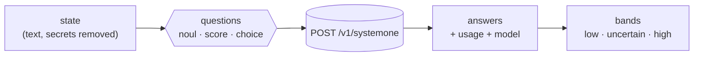

# What ClauJev asks Jev

Each hook builds a **state** (the text Jev reads) and a list of **typed questions**. This page sums
up both for every hook. The exact wording is in
[`plugins/claujev/hooks/claujev.mjs`](../plugins/claujev/hooks/claujev.mjs), in English and Portuguese
(`lang` option). Question and choice ids are the same in both languages. Before anything is sent,
the state goes through `redact()`, which removes keys and tokens.

[Português](perguntas.md)

Question types of the System One API:

| Type | The answer carries | How ClauJev uses it |
| --- | --- | --- |
| `noul` | `noul`: probability of "yes" (0..1) | as the value |
| `score` | `score` and `legend` (the levels) | normalised to 0..1 |
| `choice` | `choice`, `confidence` and `probabilities` | the chosen option, or the sum of some options |

---

## `prompt` · UserPromptSubmit

**State:** the user's request (up to 6,000 characters). Messages under 40 characters are joined to the
previous request; longer ones carry the previous request as context (up to 1,500 characters). Slash
commands, messages under 15 characters and messages Claude Code injects itself (`<task-notification>`,
`<local-command-…>`, etc.) are not sent.

| Question | Type | Options |
| --- | --- | --- |
| `task_type`: what kind of work does the request need? | choice | question · bug · feature · refactor · config · other |
| `scope`: how large is the change likely to be? | score | none · trivial · small · medium · large |
| `depth`: regardless of code, how much investigation and reasoning does it need? | score | direct answer · check one thing · cross-check a few sources · investigate several places · deep analysis |
| `ambiguous`: is the request still vague for someone who has the history? | noul | — |
| `area`: which project area is it about? *(only with `areas`)* | choice | your areas + none |

**Hints:** high ambiguity → ask first; the area's `hint` (confidence ≥ 0.5). With `sizeHints: true`
(off by default) also: question (confidence ≥ 0.6) → don't edit; a code task with scope ≤ 0.5 → go
straight to it, no subagents; scope ≥ 0.85 → plan first.

**Effort suggestion** (stored in the session state and applied by `claujev-mod` when installed): the
larger of two levels. Scope: ≤ 0.3 → `low`, ≤ 0.6 → `medium`, ≤ 0.85 → `high`, above → `xhigh`.
Depth: ≤ 0.45 → `low`, ≤ 0.8 → `medium`, ≤ 0.95 → `high`, above → `xhigh`. A question (confidence ≥ 0.6)
uses depth only and stops at `high`. A request with "ultrathink", "think hard" or similar is marked
`explicitEffort`, and the mod leaves it alone. The mod records each answer to its effort question in
`logs/effort-<day>-<session>.jsonl`.

## `bash` · PreToolUse (Bash, PowerShell)

**State:** the command (up to 4,000 characters). Plain read-only commands are not sent, including
chains like `cd repo && git status | head` where every part is a read (no redirection, substitution or
sensitive file). The guard only asks for critical changes that are hard to undo; routine push, merge,
`branch -D`, `reset --hard` and deploys are left to Claude Code's own permissions. Commands a fixed rule
settles ask for confirmation without calling Jev: force push to `main`/`master`, `npm publish`,
`terraform destroy` (or `apply -destroy`), `kubectl delete`, `gh repo delete`, `aws s3 rb`,
`aws rds delete-db-instance/cluster`, `supabase db reset --linked`, `DROP`/`TRUNCATE` (logged with `local: true`).

| Question | Type |
| --- | --- |
| `side_effects`: is it a critical change in production that is hard to undo (deleting production data or resources, destroying infrastructure, rewriting the main branch)? Push, merge, a deploy workflow, a schema migration and staging are not | noul |
| `credentials`: does it leak a credential off this machine (commit, issue, third-party service) or print a full secret? Copying an `.env` between local folders or loading it for a local tool is not a leak | noul |

**Action:** `permissionDecision: "ask"`, so Claude Code asks for your confirmation.

## `agent` · PreToolUse (Agent)

**State:** subagent type, description and prompt (up to 6,000 characters). Skipped when Claude already
chose a model.

| Question | Type |
| --- | --- |
| `simple`: can a small, fast model do this task well? | noul |

**Action:** `updatedInput.model = routeModel`. Only the model changes.

## `edit` · PostToolUse (Edit, Write, MultiEdit, NotebookEdit)

**State:** the start of the `context` files, the file path and the old and new snippet (up to 12,000
characters). Lockfiles, images and, by default, `.md`/`.txt`/`.json` are skipped.

| Question | Type |
| --- | --- |
| `r0`…`r19`: does this change break rule *N*? | noul |
| `p_<id>`: your `questions.edit` | any |

**Action:** `decision: "block"` with the list of broken rules. Claude reviews the snippet or explains
why it is a false positive.

## `subagent` · SubagentStop

**State:** the subagent's real actions, read from its transcript (tool + target), and its final report.
Only called when the subagent edited something or ran commands.

| Question | Type |
| --- | --- |
| `false_claims`: does the report claim work that is not in the actions? | noul |

**Action:** `decision: "block"`; the subagent fixes its report or does what is missing.

## `stop` · Stop

**State:** project context, the request, the edited files, the diff since the commit at the start of
the turn (up to 30,000 characters), the commands Claude ran in the turn (read from the transcript;
commands with effects in more detail, the end of the turn kept when the list is long), the `verify`
result and Claude's final reply (up to 3,000 characters). Called when the turn had an edit or a command with effects (`git commit`/`push`/
`tag`, `gh … create`, `npm publish`, deploys, `curl -X POST`, etc.). A shell command that writes files
(`sed -i`, `python … open('w')`, `cat > … <<EOF`, redirections) also counts: the diff and the new files
of the turn are read from git, including a repo the command `cd`-ed into. Turns with nothing changed
are logged as skipped.

**After a block:** the next Stop records `followUp` (tool calls after the block, and how many changed
something), without calling Jev. `report` sums it up: changed something = the block helped; only
explained = likely false alarm.

| Question | Type |
| --- | --- |
| `completeness`: counting files, commands and the final reply, how much of the request is done? | score (0–4) |
| `unfinished`: is anything left unfinished? | noul |
| `out_of_scope`: did it touch things nobody asked for? *(logged only)* | noul |
| `p_<id>`: your `questions.stop` | any |

**Action:** a warning to you (`systemMessage`) with the problems found. It only blocks
(`decision: "block"`) when the `verify` command fails, or on any problem with `stopBlocks: true`.
When Claude Code says it is already
continuing because of a hook (`stop_hook_active`), ClauJev does not block again, so there is no
endless loop.
